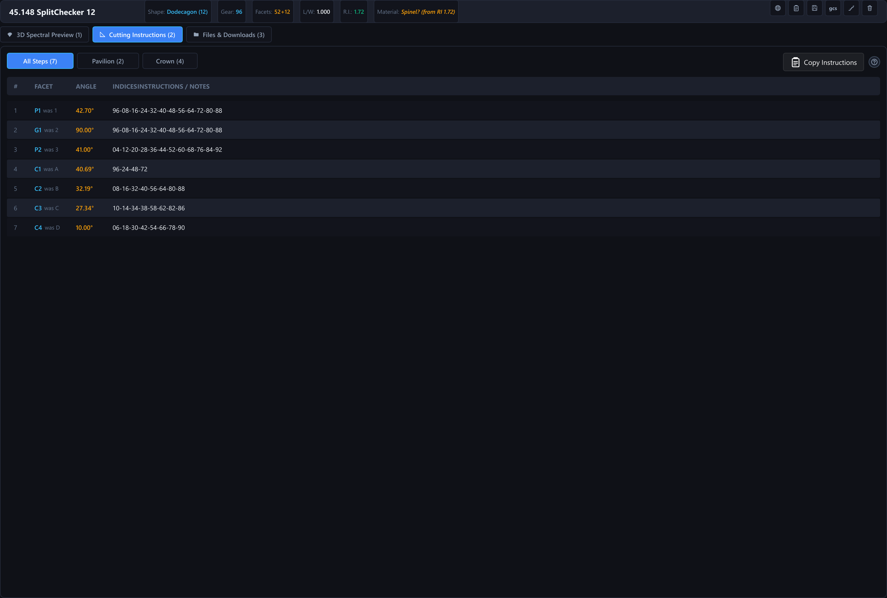
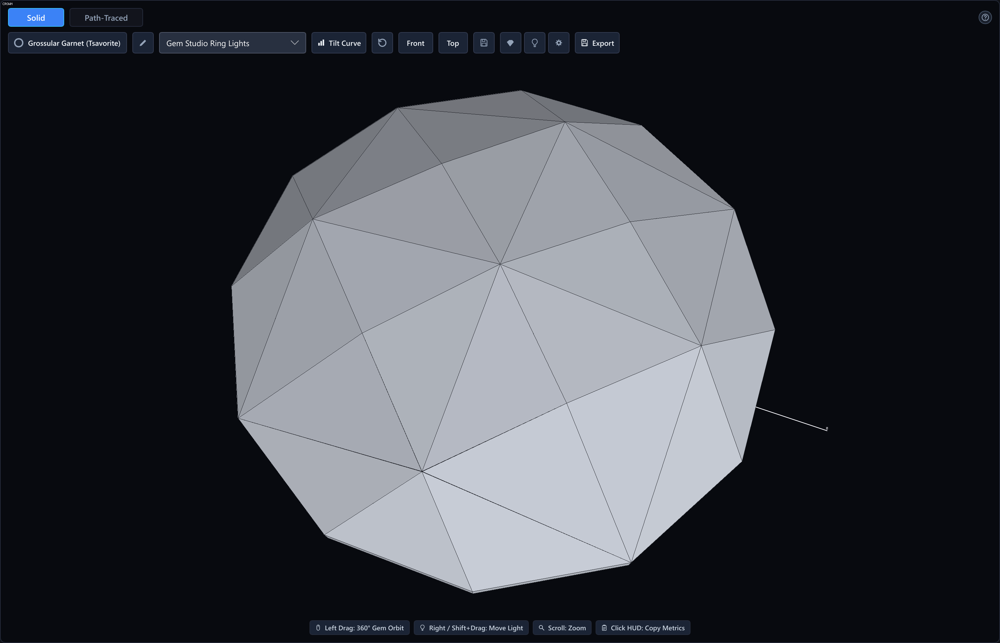
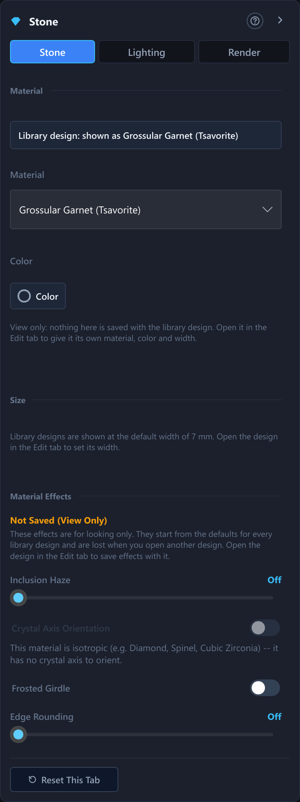
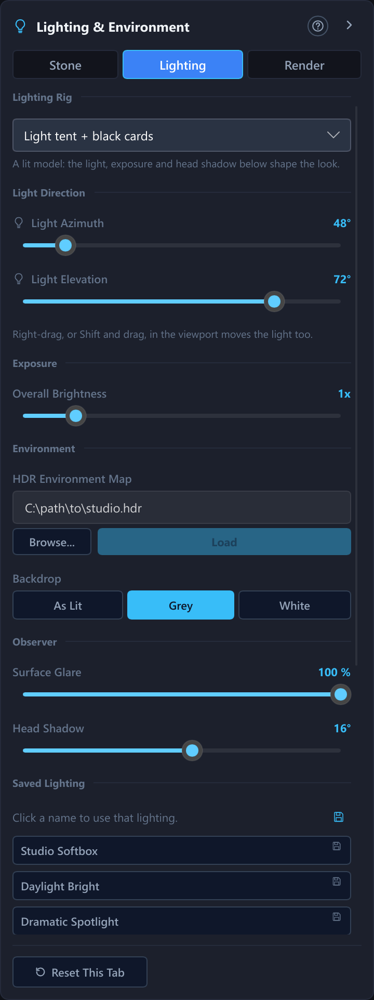
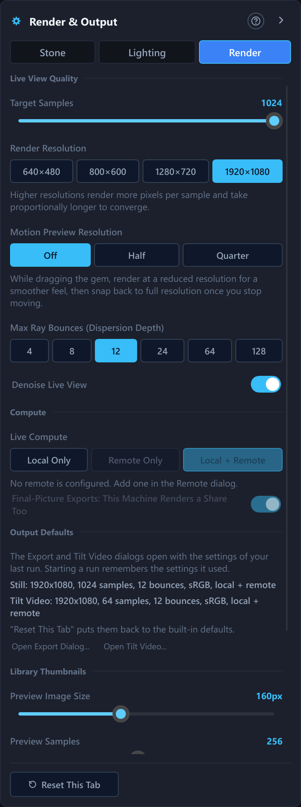
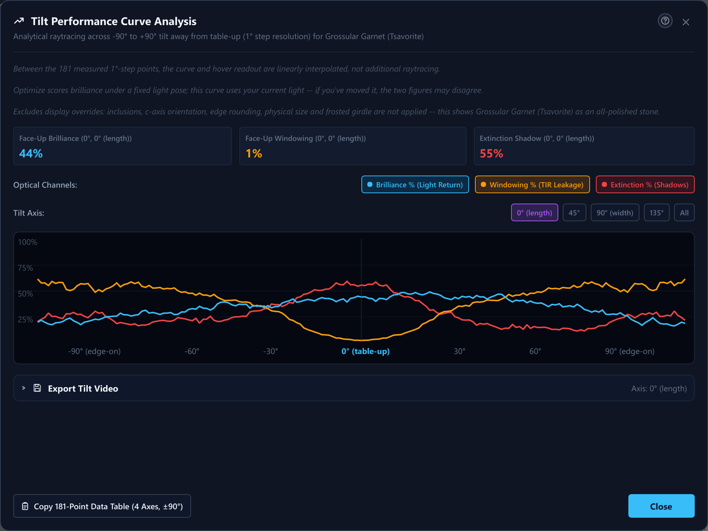

# 2. Browsing the Catalogue and Viewing a Design

## What You Will Do

This chapter covers searching and filtering your design library, selecting
a design, reading the 3D render viewport and its controls, and using the
tilt-performance graph to judge how a cut behaves as it tilts.

## Searching and Filtering

The catalogue panel on the left lists every design matching your current
search and filters, and its header reads "Catalog (N of M)" — how many
match versus how many exist in total. If nothing matches, it shows "No
diagrams found / Try adjusting your search terms or filters."

- **Search box** (top toolbar): matches against a design's title and
  designer. Its hint text reads "Search title or designer... (Ctrl+F)", and
  Ctrl+F jumps to it. A note is not part of the match — see Chapter 12. A small
  "×" appears once you've typed something, to clear it in one click.
- **Shape** and **Gear** drop-downs: filter to a specific shape
  classification or index-gear size.
- **Filters** button: opens the Advanced Filters panel (below). It turns
  amber with a dot when a filter is active but the panel is closed, so an
  active filter is never invisible.

### Advanced Filters panel

Click **Filters** to open it. The panel takes the keyboard focus: Tab walks its
controls, Escape closes it, and the **?** in its header opens this section. From
top to bottom:

1. A live count: "N of M designs match."
2. Four range sliders, each spanning the *actual* range present in your
   catalogue (not a fixed scale): **Refractive Index**, **L/W Ratio**,
   **Volume (Vol/W³)**, **Facet Count**. Drag either handle; dragging one
   past the other pushes it along.
3. **RI Match (Current Material)** — a second, independent way to filter
   by refractive index: instead of a min/max range, this centres a
   tolerance band on a chosen value ("Centre X ± Y"). The **Use Current
   Material** button snaps the centre to whatever material is currently
   loaded in the 3D viewport, so you can quickly ask "what else in my
   library has roughly this stone's RI?"
4. **Show Ignored Designs** — a toggle to include designs you have marked
   Ignored (see the catalogue card's right-click menu, below) in your
   results. Off by default; ignored rows that are shown render visually
   distinct (dimmed, amber-bordered).
5. **Tilt Performance** filters — narrow the catalogue by how a design
   actually performs when tilted, e.g. "Windowing at most 20% (worst,
   ±45°)." Build one with the metric drop-down (Brilliance / Extinction /
   Windowing), the "at most" / "at least" choice, a threshold percentage
   slider, a tilt-radius slider, and "worst" or "mean" as the aggregate,
   then click **+ Add Filter**. If any active tilt filter is excluding
   designs that have no computed tilt curve yet, an amber notice tells you
   how many. In the Advanced interface (Chapter 17) it also offers a **Compute
   Missing Tilt Curves** button to fill that gap for the whole catalogue in the
   background; in the Simple interface the notice says to switch to Advanced
   for it.
6. **My Designs Only** and **Tags** — restrict the list to the designs you
   imported yourself, or to one tag (click a tag chip again to stop). **My
   Designs Only** is greyed out while a remote library is showing.
7. **Reset Filters** — snaps every slider back to its full, unfiltered
   range and clears the toggles above.
8. **Regenerate for Filtered Set** (Advanced interface only) — **Regenerate
   Previews** and **Regenerate Tilt Curves** redo that work for just the designs
   the filters show now, which is handy after a renderer or material change.

A slider sitting exactly on its own full range's edge counts as
unfiltered on that side — this is what makes Reset genuinely clear
everything, including designs with no recorded value for that attribute.

## Selecting and Inspecting a Design

Click a card in the catalogue to select it. Each card shows two small
preview thumbnails (front and top view, once generated — otherwise a
placeholder "F"/"T"), the title, an optional shape badge, the designer, and
the gear/facet count. **Right-click** a card for:

- **Generate Previews** — render this design's own front/top thumbnails.
- **Compute Tilt Curves** — compute this one design's tilt-performance data
  (see below) ahead of time.
- **Ignore** / **Un-Ignore** — hide a design from ordinary search results
  (still visible in the Advanced Filters "Show Ignored Designs" mode).
- **Exclude from Planner** / **Include in Planner** — keep a design out of the
  Rough Planner's candidates (Chapter 15) and nothing else. Unlike **Ignore**, it
  hides nothing: the card stays in the list, marked "Not Planned", and previews and
  tilt curves are made as usual. It works on the local library only.
- **Build This Design** — turn the design into a step-by-step tutorial that
  rebuilds it from an empty design (Chapter 22); the steps button in the detail
  header below does the same.

The same actions are on the three-dot button that appears when you point at a
card, and in the **Library > Selected Design** menu, which works from the keyboard
too. To move through the list without the mouse, Tab into it and use Up and Down;
Enter or Space opens the card.

Previews and tilt curves are rendered from the design's own design file (its
`.asc`, else `.gem`, else `.gcs` attachment) when the record has one, and from
the angle table only when it has none or the file cannot be read.

The **Library** menu (Advanced interface only) has **Regenerate Preview Images...**,
**Regenerate Tilt Curves...** and **Regenerate Both...**. Each opens a question first:
**Missing or Outdated Only** (the default; it shows how many designs that is, after a
moment of "counting...") renders just the designs with no picture or curve, a missing
front or top view, or a result made with other render settings, while **All Designs**
redoes the whole library. When nothing is missing the first choice reads "All designs
are up to date" and only **All Designs** can be started. The two
**Regenerate for Filtered Set** buttons ask the same question about the filtered
designs. The offer at start-up, and **Compute Missing Tilt Curves**, are the "missing
or outdated only" choice without the question. Ignored designs are never included.
While a preview or tilt-curve batch runs, its progress line reads "Completed 37 / 412"
followed by the time left ("about 6 min left"); it says "estimating..." until a few
seconds of finished designs give a trustworthy rate, and it counts local and remote
work together.

A batch of previews or tilt curves (several designs at once, from the library
menu or the filter panel) also renders on a configured remote coordinator when
Live Compute includes it, and keeps several pictures in flight on the remote
at the same time — how many is **Remote Lanes for Batches** in the Remote
Coordinator panel (Chapter 10).

After an import you are asked whether to generate previews for the new designs:
**Full Render** traces them as above, **Quick (Solid)** draws a flat-shaded solid
picture of each in moments on the CPU, and **Skip** generates nothing. Tick
**Remember My Choice** to stop being asked (the `import_preview_choice` setting). A
solid picture counts as a stand-in: the designs that only have one are offered again for
full rendering at the next start, from the library menu's regenerate entries, or one at a
time from a design's context menu.

When several materials fit a design's refractive index, the one its previews and tilt
curves use is the one that serves the stone best on windowing, extinction and
brilliance weighted equally, measured table-up and at two tilts, so a low windowing figure
that comes with heavy extinction does not win. It is chosen once per design and kept.

A design whose file names a material, or sets a girdle diameter, is not given that choice
at all. Its previews are drawn and its tilt curves scored in the file's own material (with
the refractive index and body color the file sets for it) and at the file's own size, as in
the editor and in exports, and the detail view's 3D picture shows the same stone. A design
without a material or a size in its file, including every design built from the angle
table, keeps the choice above at the default 7 mm. The first **Missing or Outdated Only**
run after an update draws again the previews and tilt curves of the designs whose file
is a native design file (`.isdd`, or an old `.indicatrix`), because those are the ones that can name a material
or a size; the others are left as they are.

Once selected, the detail header above the tabs shows the title, designer,
and a row of spec chips (Shape, Gear, Facets, L/W, H/W, C/W, P/W, Vol/W³,
R.I.) — each chip only appears when that value is known, and pointing at one
says what the figure is. Local designs get an inline pencil to rename, an
**Edit Metadata** button for the full set of fields, and a **Delete** button
(with a confirm step: the trash icon becomes "Delete? Yes No"). Every icon of the
header can be reached with Tab, and a screen reader hears each one by name. The
**Export .gcs** button (the "gcs" icon) is part of the Advanced interface
(Chapter 17). The **?** at the right opens this section of the manual. Below the
header are three tabs: **3D Spectral Preview (1)**, **Cutting Instructions (2)**,
and **Files & Downloads (3)** — covered further in Chapters 1 and 3.

### The Cutting Instructions Tab

The **Cutting Instructions** tab (press 2) lists the selected design's steps as
a table, one row per tier: the step number, the facet name, its angle, its
index positions, and any notes. A concave tier takes two lines, the facet and the
tool line under it.

Every angle is a plain positive number; the side of the girdle comes from the
block the row belongs to, which the **Pavilion** and **Crown** pills below filter
on. The facet column shows the standard code (`P1`, `G1`, `C1`, `T`). A design
catalogued with older labels (`1`, `2`, `A`, `B`) shows the code with the
original label beside it in small type, for example `P2` with "was 3", so a
printed sheet that says 3 can still be matched to the row.

- The three pills above the table choose what it shows: **All Steps**,
  **Pavilion** (the steps below the girdle) or **Crown** (the steps above it).
  Each pill carries its own row count.
- **Copy Instructions** copies the whole table to the clipboard, ready to paste
  into a document. Clicking a single row copies just that row.
- From the keyboard, Tab into the table, then Up and Down move from row to row
  (skipping the rows the pills hide), Home and End jump to the first and last
  row, and Enter or Space copies the row you are on.
- The **?** at the top right opens this section.

If a design has no recorded cutting instructions, the tab says so.

## The 3D Viewport

Open the **3D Spectral Preview** tab's **Live Render** sub-tab.

**Camera and light controls:**

| Action | Effect |
|---|---|
| Left-drag | Orbit the camera around the stone, freely: over the table, under the culet, all the way round |
| **Front** / **Top** buttons | Snap to the canonical poses: girdle edge-on with index 0 towards you, or straight down onto the table. Distance and lighting stay as they were |
| Right-drag, or Shift + left-drag | Move the light |
| Scroll | Zoom |
| Click the metrics readout | Copy the current metrics to the clipboard |

(Shift + left-drag exists because some laptop trackpads cannot produce a
genuine right-drag gesture.)

**Toolbar controls:**

- **Material chip and badge** — the toolbar shows the material the view is drawn in
  as a small read-only chip (material name, a color swatch and the refractive
  index). It is not a drop-down any more: the material belongs to the design, and
  you change it in the **Stone** tab of the Parameters dock (below and Chapter 6).
  While you look at the stone in another material, an amber badge, **Previewing
  <material>: not the design's material**, replaces the chip and carries a
  **Back to Design** button. The badge also shows in the Edit view's toolbar, in the
  Design Settings material row, and in the Export and Tilt Video dialogs, so you
  always know which material a picture or a file will use. Nothing starts a
  preview by itself.
- **Parameters buttons** — three small buttons at the right end of the toolbar open
  the **Parameters dock** on its **Stone**, **Lighting & Environment** and **Render &
  Output** tabs (next section). The same buttons sit in the Edit view's toolbar. In a
  narrow Live Render viewport (under about 860 pixels, or about 1090 while the
  amber Previewing badge shows) the pause, stale and GPU pills, these buttons, Export
  and the badge move to a second toolbar row, so nothing is cut off.
- **Lighting** — thirteen **lighting rigs** in the list (also in the Lighting &
  Environment tab). They are listed here in the order the drop-down shows them,
  in two families:
  - **Lit models** — what a stone looks like in a real scene. They darken the facets
    that would reflect your own head, the way a face-up stone really shows a dark table
    (the Head Shadow slider below sets how much), and their brilliance, windowing and
    extinction figures count every direction that is really lit, not only the brightest
    lamp:
    - **Light tent + black cards** — the default. A jewellery light tent: grey walls,
      one broad overhead softbox, three black cards for facet contrast and a small hard
      spark light for scintillation. The softbox follows the light azimuth/elevation
      controls; the cards sit 90°, 180° and 270° around from it.
    - **Grading tray (D65 hemisphere + head shadow)** (formerly "ISO hemisphere") — the
      whole sky above the girdle evenly lit, black below. The classic light-return
      model for comparing patterns, and the light the Optimize and Retarget searches
      score under. It is flat by design, so a tilt video under it shows no sparkle.
    - **White tray (lit from below)** — a bright, perfectly even white surround (the
      walls are the same brightness from the girdle to the zenith) over a bright
      ground, no cards and no spark: a stone on a white grading tray.
    - **Jewellery shop (diffuse + spots)** — a bright diffuse ceiling (walls about
      three times the tent's), the broad key, and small pinpoint spots, the light of a
      shop window or an office.
    - **Window daylight** — a dim room lit by one broad window: a single soft key
      light with a low cone and no cards or spark. The built-in view **Window daylight**
      (Views list) selects this light and puts it at 30° elevation, as a real window
      sits; with the default light elevation it would shine from high overhead instead.
    - **Daylight sky (no sun)** — a clear sky only, brighter towards the horizon, with a
      soft glow around the light direction and dark ground. There is no sun disc in
      it. (Settings saved as "Daylight sky + sun" open as this preset, which is what
      they always drew.)
    - **Daylight sky + direct sun** — the same sky plus a real sun, a hard-edged disc
      0.27° across. At the default light height it supplies about 82 % of the light,
      the rest is sky. A facet flashes, with fire, whenever it catches the sun; the
      sun follows the light azimuth/elevation controls and goes out when the light is
      below the horizon.
    - **Contrast view (ASET-style)** — a contrast view in the style of an ASET scope.
      The sky is colored by elevation: **green** from 0° to 45°, **red** from 45°
      to 75° and **blue** from 75° to 90° overhead, **black** below the horizon.
      There is no white balance and no head shadow, so you can see where in the stone
      the light returns from. It is a diagnostic view, not a photograph, and its figures
      are scored as the Grading tray.
  - **Studio** (the analytic studio rig): **D65 Daylight (6500K)**, **Incandescent
    (3200K)**, **Incandescent A (2856K)**, **Gem Studio Ring Lights** and **Dramatic
    Dark Spotlight**. A dark velvet backdrop with a key softbox, a fill and sixteen
    ring pinpoints: hard sparkle, clipped highlights, black everywhere else.
    Incandescent A is the standard tungsten lamp (2856 K) with white balance applied.
    The brilliance figures under a Studio rig are measured against that rig's own light
    sources; the Grading tray gives the standard figure.

  At exposure 1× the lit models put their ambient light near middle grey, so only a
  direct reflection of a light source clips to white; use Exposure to go darker
  or brighter.
- **Exposure** (Lighting & Environment tab, "Overall Brightness") — the overall brightness of the picture, a
  slider from 0.4× to 2.5× (default 1×, shown next to the label). It scales the light
  of every built-in lighting rig, the lit models and the Studio rigs alike. It does
  not apply while an HDR environment map is loaded, which replaces the exposure and
  light-position controls (the map brings its own brightness). A stored value outside
  0.2× to 5× is pulled back into that range when the settings are read.
- **Light Direction** (Lighting & Environment tab, above Exposure) — where the main light
  shines from, as two angles. **Light Azimuth** is the angle around the stone, 0° to
  360° (default 48°). **Light Elevation** is the height above the stone, about 8.6° (low and
  raking) to about 88.8° (nearly straight overhead) (default 72°). Besides the two sliders,
  you can move the light in the viewport itself: right-drag, or Shift + left-drag,
  changes both angles at once (the table above). The direction moves the light tent's
  overhead softbox (the black cards turn with it), the sun of **Daylight sky + direct
  sun**, the glow of **Daylight sky (no sun)**, the window of **Window daylight** and
  the key softbox of the Studio rigs. The **Grading tray** does not depend on it: the
  whole hemisphere is lit evenly, so the light direction changes nothing there. An HDR
  map ignores it too.
- **Views** (Lighting & Environment tab, the **Saved Lighting** list) — one-click saved looks.
  A view is a complete look: it stores the lighting rig *and* the light
  direction (azimuth and elevation), the exposure, the surface glare, the backdrop,
  the head shadow, the HDR environment map if one is loaded, and the camera distance;
  for some views also the camera pose. Click a name to apply the view. Applying it
  sets every one of those values, so a view saved without an HDR map also takes a
  loaded map away and returns to its lighting rig; applying one that stores
  no camera pose leaves your current turn around the stone alone. (Views saved by an
  older version did not store glare, backdrop or head shadow; they open with 100 %
  glare, the grey backdrop and a 16° head shadow.) Seven views come
  with the app and cannot be renamed or deleted:

  | View | Lighting rig | Light azimuth / elevation | Exposure | Camera |
  |---|---|---|---|---|
  | Studio Softbox | Gem Studio Ring Lights | 48° / 54° | 1× | not set |
  | Daylight Bright | D65 Daylight (6500K) | 30° / 65° | 1.3× | not set |
  | Dramatic Spotlight | Dramatic Dark Spotlight | 300° / 25° | 0.7× | not set |
  | Light Tent | Light tent + black cards | 48° / 72° | 1× | not set |
  | Grading tray | Grading tray (D65 hemisphere + head shadow) | 48° / 72° | 1× | azimuth 20°, elevation 85° (looking almost straight down) |
  | Daylight Sun | Daylight sky + direct sun | 30° / 55° | 1× | not set |
  | Window daylight | Window daylight | 40° / 30° | 1.2× | not set |

  The **Save Lighting** button on the viewport toolbar (hidden in Simple mode)
  captures your current lighting, light direction, exposure and camera pose; the
  save button in the Saved Lighting heading saves the current
  lighting without the camera pose, and **Save View as Saved Lighting...** in the
  Camera section keeps the pose too. The name box opens pre-filled with
  "<rig> – <date>" (for example "Light tent + black cards – 2026-10-12", numbered
  "(2)", "(3)" if the name is taken), so a saved lighting never shares a name with a
  rig; press Enter to keep it or type your own. Your own views are added to the same list, after
  the built-in ones, and can be renamed and deleted (the pencil and trash buttons). Every
  row, built-in or yours, has a small save toggle, the "usable for" mark: switch it on
  and the view is offered in the export dialog's list of lightings, so one export can
  render the stone under several of them (Chapter 9). New views start with it off.
- **Backdrop** (Lighting & Environment tab, Environment section) — what the camera sees behind
  the stone: **As Lit** (the environment's own ground), **Grey** (the default:
  a neutral grey card, the convention gem-design programs use for like-for-like
  comparisons) or **White**. Only
  the camera sees it; the stone's optics never do, so leakage and windows stay dark.
- **Surface Glare** (Lighting & Environment tab, Observer section) — a 0–100 % slider in steps of 5
  (default 100 %). It scales the white mirror image of the light that a polished
  surface reflects, which is what a cross-polarised photograph removes: at 0 % the
  bright reflection of the light on the table disappears and the inner facets stay
  visible, while the light that entered the stone is untouched. It applies to the
  built-in lighting rigs (Studio and the lit models), not to an HDR environment
  map (the slider greys out while one is loaded), and it follows into the live view,
  remote and hybrid rendering and every export. The brilliance, windowing and
  extinction numbers, tilt curves and catalogue previews never use it, and the Solid
  view is unaffected. "Reset to 100 %" restores the default.
- **Head Shadow** (Lighting & Environment tab, Observer section) — a 0–30° slider (default 16°,
  0 = Off). On the lit models it is how much of the sky your own head hides: the
  dark table reflections a face-up stone shows. 16° is a head at arm's length. The
  slider now also changes the brilliance, windowing and extinction figures under those
  presets, not only the picture, so a wider head shadow lowers the face-up brilliance.
  The Studio rigs (D65 Daylight, Incandescent, Incandescent A, Ring Lights, Dark
  Spotlight) ignore it, and so does an HDR map (the slider greys out
  while one is loaded; with a studio rig it greys out too and says "(not used by studio rigs)"). It follows into the live view, remote and hybrid rendering
  and every export; "Reset to 16°" restores the default.
- **Tilt Curve** — opens the tilt-performance dialog (below). Simple mode hides
  this button (Chapter 17); switch to Advanced to use it.
- A reset-camera button, a "Save Lighting" button (captures your full
  current lighting *and* camera pose as a named saved lighting; Simple mode hides it), a
  Pause/Live toggle, the three Parameters buttons, and an **Export** button (Chapter 9).
- A round **?** button opens this part of the manual. Every button on the toolbar
  also has a hover note saying what it does, and you can reach each one with the
  Tab key and press it with Space or Enter.

**A stone that is cut back.** The Edit tab's Cut slider (Chapter 13) can show the
stone part-way through the cutting, and the Live Render view follows it. While it does,
a small amber badge over the picture says so and names the step, and its **Show
Finished** button puts the slider back to the finished stone. The badge appears only
for the design open in the Edit tab: a catalogue row you are browsing is always drawn
whole. Exports, the tilt video and the tilt curves never use the part-cut stone; they
always draw the finished gem (Chapter 9).

The material lists (the Stone tab's Material and Preview as combos, the New Design
dialog and the others) all show the same 34 built-in
materials (including the zoned Ametrine) in alphabetical order (Diamond, Sapphire, Tourmaline, the
various garnets, Aquamarine, Morganite, and the rest — see Appendix C's
materials table for the full list and their optical values), followed by
any custom materials you create yourself. Saved settings remember the
material by name, so the ordering never affects what is restored.

**Optical performance readout:** the on-screen metrics are Brilliance
(percentage of light returned to the eye), Fire (a unitless index of
spectral flare), Scintillation (percentage), Windowing (percentage of the
face that reads as see-through rather than reflective — turns red above
10%), and Extinction (percentage of the face that reads as dark shadow
instead of bright — turns amber above 12%).

## The Parameters Dock

Everything that describes the stone, its light and the technical render options lives in
one **Parameters dock**, a panel on the right-hand side with three tabs:

| Tab | What it holds |
|---|---|
| **Stone** | The design's material and color, the stone width, and the stone's render effects |
| **Lighting & Environment** | The lighting rig, light direction, exposure, HDR map and backdrop, the observer (glare, head shadow), saved lighting, this design's lighting and the camera |
| **Render & Output** | Live-view quality and compute, the output defaults of the Export and Tilt Video dialogs, the catalogue thumbnails and the tilt curve |

Open it from any of these places; they all lead to the same panel:

- The three **Parameters buttons** at the right end of the Live Render toolbar and of the
  Edit view's toolbar. The button of the tab that is showing is lit; pressing it again
  folds the panel.
- The **View** menu: **Stone Properties**, **Lighting & Environment**, **Render &
  Output**, and **Show the Parameters Panel** (which reads **Fold the Parameters Panel
  Away** while the panel is open).
- The keyboard: **Ctrl+Alt+1**, **Ctrl+Alt+2**, **Ctrl+Alt+3** (Appendix B).
- The command palette (Chapter 19): "Stone Properties...", "Lighting & Environment..." and
  "Render & Output...". The older "Render Settings..." entry still works and opens the
  Render & Output tab.

The dock is available in the Live Render view *and* in the Edit view, so the same
controls are within reach while you cut. Which tab is open, and whether the dock is
folded, is remembered for the next start. A folded dock leaves a narrow rail of three
icon buttons. The dock sits beside the picture when the viewport keeps room: in Live
Render the window must be about 1444 pixels wide with the library open (about 1144 with
the library on its rail); in the Edit view about 1458 pixels with the library on its
rail (about 1758 with it open), plus about 272 pixels while the guide is docked. Where
the dock fits only with the library on its rail (Live Render 1144 to 1444 pixels wide,
the Edit view 1458 to 1758), the library folds itself to its rail and comes back when
the window is wide enough for both; folding or opening the dock does not change that
(a library you folded yourself stays folded). In a narrower window the open panel floats over the right edge
instead; **Esc** folds it. F1 with the panel open opens the manual at the section of
the tab that shows. The round **?** in the dock's header opens
this section of the manual.

At the foot of each tab, **Reset This Tab** asks for confirmation (press it once to see
"Reset <tab>?", then **Confirm**, or **Cancel**). It puts back the defaults of that tab
only:

- **Stone** resets only the stone's render effects (below). It never touches the
  material, the color or the width, because those are edits of the design you can undo.
- **Lighting & Environment** returns to the default rig, light direction, exposure, glare,
  head shadow and backdrop, and drops a loaded HDR map. Saved lighting is kept.
- **Render & Output** puts the live-view quality, compute and thumbnail values and the
  output defaults back.

## The Stone Tab

The design is the single source of truth for the stone. Everything here applies at once
and, except where it says otherwise, is saved in the design and can be undone.

**Material and color.** One **Material** combo (built-in materials, then your own, then
"Custom RI..."), the **RI Override** (Advanced), the **Eff. RI** and **Crit.** chips,
**New/Edit Material...**, and the **Body Color** combo with its tone/saturation/hue editor.
Choosing a material or color is an undoable edit of the design; the Edit view's Design
Settings panel shows the same material as a compact read-only chip with an **Edit in
Stone Tab** link. Chapter 6 explains what the material changes and what it does not.

**Preview As...** A second combo that shows the stone in another material *without
changing the design*. While you preview, the picture, exports and tilt videos use the
preview material, and a persistent amber badge says so in the Stone tab, in both toolbars,
in the Design Settings panel and in the Export and Tilt Video dialogs: "Previewing
<material>: not the design's material". **Back to Design** ends it. A preview never starts by itself, and
no other control can leave the view on a material different from the design's: choosing
a material in the Material combo edits the design (and an undo step), it does not start
a preview, and while a preview is on the design's own edits are still made to the
design. While previewing, a **Preview Color** control tries a color on the preview
material (view only). **Save & Apply** in the material editor and a color taken from the
Rough Planner are explicit changes of the design's material: each is one undo step and
ends a running preview.

**Library designs.** When the Live Render view shows a catalogue row you are only
browsing, there is no design material to change. The tab then says **Library design:
shown as <material>** and offers a view-only **Material** and **Color**, remembered as
your preference for library rows and never saved with the catalogue entry. The stone is
shown at the girdle diameter its design file sets, or at the default 7 mm when the file
sets none, and the effects below start from the defaults and are marked
**Not Saved (View Only)**. Open the design in the Edit tab and its own values return.

**Stone Width (mm).** One field, the design's girdle diameter, with undo. The Preform tab's
**Girdle Diameter** is the very same value, so editing either field changes both, and a
refresh of the design never overwrites a number you are still typing. Press Enter (or
leave the field) to apply; the Preform tab's field applies the same way, on Enter or
when you leave it. You can type arithmetic such as `6.5+0.25`. A blank field
means "not set": the tab then says "Not set in the design: colors are shown for 7 mm".
The note under the field says where things stand: "Saved in the design: X mm.", "Not
set in the design: ..." or "Not applied yet: press Enter ..." while what you typed
differs from the design. The width matters because color depth grows with size
(Chapter 6).

**Material Effects.** Four effects that belong to the individual stone and are saved in
its design file (a `[render_effects]` table; Chapter 11):

- **Inclusion Haze** — a milky veil from clean to milky. The slider is finer at the clean end.
- **Crystal Axis Orientation** — off renders the axis as cut; on exposes a tilt 0–90° from the
  table normal and an azimuth 0–360° (only meaningful for a birefringent material).
- **Frosted Girdle** — draw the girdle ground instead of polished.
- **Edge Rounding** — soften the facet edges toward a faint rounded glint.

A new design starts with all effects off, and opening a design restores its own values,
so switching designs never carries one stone's effects over to the next. Dragging a slider
shows the result at once and is written to the design as a single undo step when you
pause. **Reset This Tab** turns all four off (one undoable edit).

*Older settings.* Earlier versions kept these effects and the stone size once for the
whole app. The first time the new version opens a design, any non-default effects or
size from your old settings are applied to that design once (one undo step) and are
ignored from then on. Because that is an edit, the design shows as changed the moment it
opens (closing it asks about unsaved changes); **Undo** removes it.

## The Lighting & Environment Tab

One set of values describes the lighting everywhere: the live view, the lighting stored
for a design, your saved lighting and the lighting a render job freezes. The tab has these
sections:

- **Lighting Rig** — the thirteen rigs listed under *Lighting* above (the toolbar's
  Lighting combo is the same control). A studio rig, a lit model or an HDR map replaces
  the others.
- **Light Direction** — Light Azimuth and Light Elevation; you can also move the light by
  right-dragging, or Shift + left-dragging, in the viewport.
- **Exposure** — "Overall Brightness".
- **Environment** — the **HDR environment map** loader and the **Backdrop**.
- **Observer** — **Surface Glare** and **Head Shadow**. Both grey out while an HDR map is loaded.
- **Saved Lighting** — your named looks plus the seven built-in ones: apply, save, rename,
  delete, and the "usable for" switch that offers a look in the export dialog (Chapter 9).
  A saved lighting holds the whole look: rig, light direction, exposure, glare, backdrop,
  head shadow, the HDR map if any, and optionally the camera pose.
- **This Design** — **Use This Lighting for This Design** and **Forget for This Design**
  (the group called "Lighting This Design Opens With"; Chapter 9).
- **Camera** — **Front**, **Top**, **Reset**, and **Save view as saved lighting...**.

Because the tab is in the Edit view too, the Path-Traced and Both modes can be lit without
leaving it, and the Optimize tab's note about the studio rig links straight here
(**Change the Lighting Rig...**).

## The Render & Output Tab

Open the **Render & Output** tab for the list below. Every setting has a hover note that
says what it does.

In **Simple mode** (Chapter 17) the tab shows Target Samples, Render Resolution, Denoise
Live View and the output defaults. It hides Library Thumbnails (Preview Image Size and
Preview Samples), Motion Preview Resolution, the Compute section (Live Compute with Live
Transfer, Local Compute), Max Ray Bounces and the Tilt Performance Curve panel; those are
the Advanced settings below. A hidden setting keeps its value and still applies. If one of
them is not at its default, the tab says "Some advanced settings are in use. Switch to
Advanced to see them."

**Live View Quality**

- **Target Samples** — how many samples per pixel the live render converges to, in powers
  of two (8 up to 1024; default 256). More samples mean a cleaner, less grainy image but a
  slower render.
- **Render Resolution** — four fixed choices: 640×480, 800×600 (default),
  1280×720, 1920×1080.
- **Motion Preview Resolution** (Advanced) — Off (default), Half, or Quarter: while
  you're actively dragging the camera, the app can render at a reduced
  resolution for smoother movement, then snap back to full resolution once
  you stop.
- **Max Ray Bounces** (Advanced) — 4, 8, 12 (default), 24, 64, or 128. Higher values
  model more light bounces (useful for strongly dispersive or heavily
  faceted stones) at a rendering-time cost that grows faster on GPU than
  on CPU. The same six choices appear in the Export and Tilt Video dialogs.
- **Denoise Live View** — smooths the grain out of the live picture while it builds up. It
  is the same switch as the Remote Coordinator dialog's "Denoise Merged Image".

**Compute (Advanced)**

- **Live Compute** — Local Only, Remote Only, or Local + Remote (default,
  once a remote coordinator is configured) — see Chapters 9 and 10. The remote choices are
  offered only when a coordinator is configured, and a greyed choice says why in its hover
  note. Below it, the **Live Transfer** of the remote is shown read-only, with an **Open
  Remote Settings...** link; it is one control per remote, set in the Remote Coordinator
  dialog (Chapter 10).
- **Local Compute** — CPU, CPU + GPU (default), or GPU Only. **This choice
  only appears on a build compiled with GPU support**; an ordinary build
  has no such choice and always renders on CPU. Even "GPU Only" quietly
  falls back to CPU for a scene the GPU can't handle (no usable graphics
  adapter, or an HDR environment map too large for the graphics card's
  memory limits), so nothing ever fails to render outright.

**Output Defaults.** The Export and Tilt Video dialogs open with the settings of your last
run: output size, samples, bounces, color space, compute target and transfer (and, for the
video, the file-name template). Starting an export or a video remembers the values it used.
The tab shows both sets as two read-only lines; the controls themselves are in the
dialogs, where you can still change them for a single run. The links **Open Export
Dialog...** and **Open Tilt Video...** under the lines open those dialogs. Resetting the tab puts the
defaults back.

**Library Thumbnails (Advanced)** — **Preview Image Size** (96 to 256 pixels) and
**Preview Samples** (32 to 512) for the small pictures the catalogue draws.

**Tilt Performance (Advanced)** — the button that opens the tilt-performance graph
(below).

## Reading the Tilt-Performance Graph

Click **Tilt Curve** to open **Tilt Performance Curve Analysis**. This
answers a real cutting question: how does the stone's performance hold up
as it tips away from being viewed straight-on?

The sweep covers −90° to +90° of tilt away from "table-up" (looking
straight down through the table), in 1° steps, for the material currently
selected. A caption reminds you that between the 181 measured points, the
curve and any hover readout are straight-line interpolated, not
freshly ray-traced.

**The three curves:**

- **Brilliance % (Light Return)** — the percentage of light returned to
  the eye at that tilt.
- **Windowing % (TIR Leakage)** — the percentage of the face reading as
  see-through: light is passing straight through the pavilion instead of
  reflecting back, the classic "fish-eye" look.
- **Extinction % (Shadows)** — the percentage of the face reading as dark,
  dead shadow instead of bright.

Choose a **Tilt Axis** — 0° (length), 45°, 90° (width), or 135° — to see
the sweep along one particular compass direction around the stone, or turn
on **All** to overlay all four at once. Three badges report the face-up
(0° tilt) values for whichever axis is selected: Face-Up Brilliance,
Face-Up Windowing, and Extinction Shadow.

Computing all four full sweeps takes about a second and a half; the dialog
shows an explicit "Sweeping..." message rather than a silent spinner while
it works, and the result is kept so reopening the dialog on the same
inputs doesn't repeat the wait.

**Hovering the chart** snaps to the nearest whole degree and shows a small
floating card with a live mini-render of the stone at exactly that tilt
and axis, plus the interpolated value of each visible curve at that point.

**If you change material after a curve was already computed and cached**,
the dialog shows a banner: "This cached curve was rendered with
&lt;old material&gt;, not the current material (&lt;current&gt;)." with a
**Re-Render Fresh** button. Clicking Re-Render always computes a genuinely
fresh sweep for the current material; opening the dialog while the cached
curve belongs to a different material triggers this recompute
automatically, without you needing to notice or click anything.

A **Copy 181-Point Data Table** button at the bottom copies the full
numeric sweep (all four axes) to the clipboard for your own analysis.

## Next Steps

Continue to Chapter 3 to load a design into the editor, or Chapter 9 to
export a still image of what you're viewing here.
