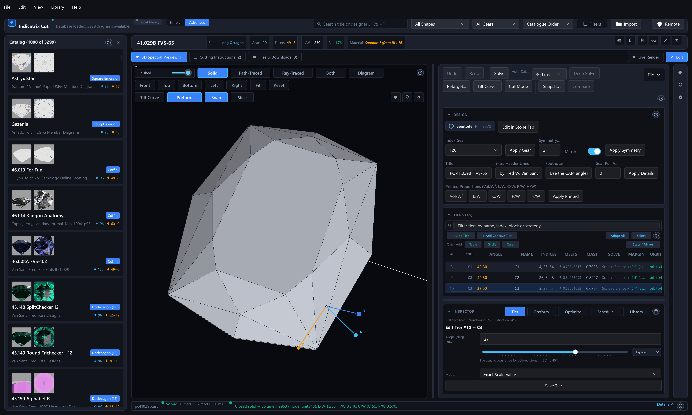

# 3. Loading a Design into the Editor and Understanding the Tier List

## What You Will Do

This chapter gets a design open in the editor and explains every column of
the tier list, so the numbers on screen make sense before you touch
anything.

The editor described in this chapter and Chapters 4–8 ships in every build
of the app (see Chapter 1): the "Edit" sub-tab sits next to "Live Render."

## The Editor's Toolbar

The command bar is one compact row of grouped buttons; in a narrower dock it
wraps into two rows. Each row ends in empty space rather than spreading its
buttons out, and a single hint line underneath shows an explanation of
whatever button you are currently hovering. Tab reaches every button and Space
or Enter presses it, and a screen reader hears the same hint as the button's
description. The **?** at the right end of the hint line opens this section of
the manual. The groups, left to right:

- **Undo, Redo.**
- **Solve, Auto-Solve, Deep Solve** — Solve, the auto-solve delay control next
  to it, labelled "Auto-Solve:" (Off / 150 ms / 300 ms / 1 s / 3 s — Chapter
  5), and Deep Solve (Advanced interface). Deep Solve greys out when there is
  nothing for it to do, and hovering a greyed-out button shows the specific
  reason right on the button.
- **Retarget..., Tilt Curves, Cut Mode** — Retarget is an automated proposal
  for adapting a design to a different material (Chapter 6).
- **Snapshot, Compare** (Advanced interface, Chapter 17).
- **File** — a menu with New Design..., Open..., Load Selected, Save, Export .asc...,
  Export Cutting Sheet (HTML)..., Export Diagram (PNG)... and, in the Advanced
  interface, Export as Gem Cut Studio (.gcs).... When the design will ask before it
  saves, **Will Ask Before Saving** sits beside the button. See Chapter 11 for
  what each item actually writes.

The tier actions are not on the command bar. **+ Add Tier** and **+ Add
Concave Tier** are in the tier list's header, each row has its own Move,
Duplicate and Delete buttons (Ctrl+D and Delete work on the selected row), and
**Optimize** has its own Optimize and Cancel buttons on the inspector's Optimize
tab (Chapter 4).

Undo and Redo say what they are about to do, rather than a bare "Undo"
and "Redo" — hover either button, or open the Edit menu, and you will see
something like "Undo: Set P1 angle to 41.0 degrees" or "Redo: Add tier
C1'". This works for every kind of edit the app makes, including a Retarget
or an Apply Optimize Result.

## Some Terms First

- **Tier**: one row of the cutting instructions — one facet, or one symmetric
  family of identical facets cut at the same angle and depth.
- **Index**: the position on the cutting machine's dividing head (its
  "gear") where a facet is cut. A design with a 96-tooth gear has 96
  possible index positions around the stone.
- **Orbit**: the complete set of index positions that a symmetric tier
  occupies. On an 8-fold, 96-tooth design, one orbit of a facet that
  appears once per repeat has 8 members, 12 teeth apart.
- **Girdle, crown, pavilion**: the three vertical "blocks" of a stone — the
  girdle is the narrow band at the widest point, the crown is everything
  above it (culminating in the table), the pavilion is everything below it
  (culminating, on most cuts, in a culet or point).
- **Meet point**: the point where three or more facet planes intersect. A
  facet's actual depth is determined by where its plane meets its
  neighbours — you rarely set a depth number directly; you say what the
  facet *meets*, and the app works the depth out.
- **Mast**: the solved distance of a facet's plane from the centre, along
  its own normal — this is the number a real cutting machine's mast gauge
  would read. It is always a solver *output*, never something you type in.
- **Anchor**: a tier whose scale is stated directly rather than derived from
  meeting other facets. Every block (crown, pavilion, girdle) needs at
  least one anchor, or its overall size has nothing to be measured against.

## Loading a Design from the Catalogue

1. Select a design in the catalogue panel (Chapter 2).
2. Open the 3D tab's **Edit** sub-tab.
3. Choose **File**, then **Load Selected**, on the command bar.

What happens next depends on the design and where it lives:

- **A remote-library design**: Load Selected fetches that entry's own
  `.asc` file over the network from the worker and loads it exactly like a
  local one, with a matching toast, `Loaded '<name>' into the editor.`,
  naming the file itself rather than the catalogue title (a remote fetch
  never carries the two together). This needs a real attached `.asc` file
  on the worker's side; a remote design with none fails with
  a clear error message instead of the placeholder reconstruction a local
  design in the same situation gets (Chapter 12). There is nothing to
  switch or reconfigure first; you do not need to be browsing your local
  library to load a remote design into the editor.
- **No design selected**: "No diagram selected to load."
- **Local design with an attached `.asc` file**: the editor parses that
  file and builds the tier list from its exact recorded masts. Every tier
  starts pinned to that exact value (an anchor) — see "Pinned vs. Free
  Tiers" below. You get a toast: `Loaded '<title>' into the editor.`
- **Local design with no attached file, but a stored cutting-instructions
  table**: the editor reconstructs a schedule from that table, but it has
  no way to recover the original masts, so every mast is filled with a
  placeholder of `0.0`. You get an informational toast: "Loaded a
  reconstructed schedule -- mast distances are placeholders (no attached
  .asc file was found); adjust masts before exporting." Do not export this
  as-is — solve it and, where needed, add real scale-reference values
  first.
- **Neither**: "This diagram has no cutting-instructions data to load."

**Loading solves immediately.** As soon as a design loads, the app runs a
full solve, so the tier list's MAST and SOLVE columns are already filled in
by the time you see it.

## Starting a New Design Instead

Choose **File**, then **New Design...** on the command bar (or File → New Design... at the top of the window) to open the New Design dialog rather
than loading an existing design: pick the preform shape and dimensions, the
index gear, symmetry order, mirror, and a starting material, then click
**Create**. Every one of these stays editable afterward — gear, symmetry,
mirror and material through the Edit tab's Design Settings panel (Chapter
6), the preform through the inspector's own Preform tab (Chapter 4) — see
the worked example in Chapter 7.

The dialog is a template gallery: pick one of the everyday shapes (round
brilliant, oval, cushion, emerald step cut, princess), one of the round variants
and teaching designs, or **Empty** for a blank draft (Chapter 1, "Starting from
Nothing"). A stone template arrives with its tiers already written; a blank draft
starts with zero tiers, and its very first Add Tier defaults to angle 0.0 and
"Unspecified Vertex". Chapter 7's worked example takes you through building a
stone by hand from the blank draft.

## Reading the Tier List

Each row is one tier. The columns are:

| Column | Meaning |
|---|---|
| **#** | The tier's position in the schedule. |
| **⚠** | A warning glyph when this tier has its own manufacturability warning (Chapter 5) — hover it to read the warning. Blank otherwise. |
| **CODE** | The tier's label on the cutting sheet (Chapter 11): P1, P2, ... for pavilion tiers, G1, ... for girdle tiers, C1, C2, ... for crown tiers, T for the table and Culet for the culet. The codes are numbered separately for each letter, in the order the tiers are cut, so the numbers do not have to follow the order of the rows; a concave tier carries on the count of its side. The letter is the block this tier's angle actually classifies into — Crown, Pavilion, or Girdle, regardless of what you meant it to be (see "Anchors and Blocks" below). Hover for the full block name. |
| **ANGLE** | The facet's cutting angle, in degrees off the girdle plane, always shown as a plain positive number. Which side of the girdle the facet is on is not in the number: the letter of the CODE column says it (a pavilion facet sits below the girdle, a crown facet above it), and a tier keeps its side when you edit its angle. Only the files keep the older convention of a negative angle for the pavilion (Chapters 4 and 11). A single click on this cell selects the row, like clicking anywhere else in it; double-click it (or press F2 on the selected row) to edit the value in place — see Chapter 4. |
| **NAME / INDICES** | The facet's name (or "(unnamed)"), and the index position(s) it occupies. These two columns stretch with the width of the dock; every other column stays a fixed width. |
| **MEETS** | What the tier's constraint actually is: a pin glyph and the stated value for an anchor, "meets `<names>`" for named facets, or a plain "meet" for an unspecified vertex. |
| **MAST** | The solved depth — filled in only after a successful Solve, shown as `-` or `?` when the design hasn't been (re-)solved since this row last changed. |
| **SOLVE** | How confident that mast value is — see "Trusting the SOLVE Column" below. Hover the cell for a one-line explanation of exactly why, when the app has one to give. |
| **MARGIN** | For a pavilion tier, how far its angle sits above the design's critical angle — Chapter 6. A dash for crown and girdle tiers. |
| **ORBIT** | Whether the tier's indices form one clean symmetric family — see "Orbits" below. When it is amber (incomplete), click it to fill in the missing symmetric positions automatically. |
| **IMPORTED** | Shows an **Adopt** link when there is a better constraint recoverable from the original file — see Chapter 8. |

**In the Simple interface** (Chapter 17) the table shows fewer columns: the
**MAST**, **SOLVE**, **ORBIT** and **IMPORTED** columns, the **Pin** and
**Detach / Reattach** buttons, the **Adopt All** button, the Steps / Mirror
tools and the filter box are hidden. Hiding changes nothing about the design
or about what Solve does; the columns come back when you switch to Advanced. A
stale filter text does nothing while the filter box is hidden, so no row is
dimmed by something you cannot see. When any tier is detached, a line under the
toolbar reads "Some advanced settings are in use. Switch to Advanced to see
them." The rest of this section describes the Advanced table.

Every column heading, button and field has a hover tip in plain words, ending
with "See the glossary." where the Glossary (Appendix A) has an entry for it.
The table is one Tab stop; its keys are in Chapter 4, "Keyboard Navigation in
the Tier List."

To the right of those, per row: a small up/down pair to move the tier
earlier or later in the table, and so in the cutting order of its side of
the stone (the same as Alt+Up/Alt+Down — Chapter 4), a **Detach / Reattach** toggle, a duplicate button, and a remove ("×")
button — all covered in Chapter 4. A row needing an anchor (Chapter 5)
also shows an **Add Anchor** button that jumps the inspector straight to
that tier with "Exact Scale Value" already selected, ready for you to type
the number and save. **Add Anchor does not create a new tier or fill in a
number for you** — it only selects the existing tier the app already
flagged as the one missing an anchor, and opens the Tier form to it with
the constraint kind preset; you still type the actual scale value and
click Save Tier yourself.

The first time (each session) a design you're editing lacks an anchor, a
one-time card explains why the solver needs one before Add Anchor even
does anything: relative "this meets that" statements fix a block's shape
but never its size, so one tier per block has to state a real, authored
depth. Click **Got It** to dismiss it, or tick **Don't Show Again** to
stop it appearing for good — that choice is remembered across sessions.

A tier whose SOLVE strategy is trusted (see below) also shows a **Pin**
button, the mirror image of Adopt (Chapter 8): click it to freeze that
tier's *current* solved mast as an exact **Exact Scale Value** anchor,
converting a free (meet-derived) tier back into a pinned one. This is
useful once Solve or Optimize has found a mast you want to lock in place
so further edits elsewhere cannot move it. Pin is hidden on a tier that is
already an anchor, and on any tier whose SOLVE strategy is still uncertain
(amber) — pinning a stale or placeholder mast would freeze the wrong
number, so the app does not offer it until the value is trustworthy.

Above the column headers is a small filter box: type a few letters of a
name, index, block, SOLVE strategy, or meet constraint and every
non-matching row dims (rather than disappearing) so the row numbers and
Up/Down/Home/End behaviour stay exactly as they would with no filter set.

If two or more rows are Ctrl-clicked into a multi-select group (Chapter 4),
a small bar above the table shows "N selected" with **Clear** and
**Delete** buttons — Delete removes every selected tier as one Undo step
per tier. Shift-click a row instead to select every tier between it and
whichever row you selected last, inclusive; see "Selecting Several Tiers
for a Batched Nudge" in Chapter 4 for how that range then behaves.

A tier that is cut frosted, as a whole or facet by facet, carries a small frost
icon in its row; hover it to read "Frosted" or, for a tier frosted facet by facet,
"Frosted: 2 of 8" (Chapter 4, "Frosting a Tier").

If there are no tiers yet, the list reads: "No tiers yet -- open the Tier
tab below to add one."

### Trusting the SOLVE Column

The SOLVE column names the method that produced a tier's mast. The exact
label is one of:

| Label | Meaning | Trust it? |
|---|---|---|
| **Scale reference** | An anchor tier (Meets: Exact Scale Value) — the mast is exactly the number you typed, not derived. | Yes |
| **Dependency order** | A real meet vertex, settled directly in the solver's first pass. | Yes |
| **Joint group** | A real meet vertex from a mutually-dependent group the solver had to settle together rather than in strict order. | Yes |
| **Least-squares est.** (bold amber) | No usable meet-vertex candidate; this is a per-block estimate, not real solved geometry. | No — treat the design as not actually finished |
| **FAILED (untrusted)** (bold amber) | The solve could not even produce an estimate; the mast shown is a placeholder. | No |
| **not solved** (bold amber) | This row has changed since the design's last successful Solve. | No — click Solve |
| **blocked** (bold amber) | This tier's own block is fine, but *another* block in the design has no anchor, so nothing solves yet. | No — fix the other block (Chapter 5) |
| **no anchor yet** (bold amber) | This tier's own block is the one missing an anchor. | No — Add Anchor (below) or Chapter 5 |
| **stale (‹label›)** (bold amber) | A cached result is shown without a fresh solve, e.g. "stale (Least-squares est.)" — the parenthesised label is what it was at the last real solve. | No — click Solve |

Hover any SOLVE cell for a one-line explanation specific to that tier when
the app has one to give.

### Orbits

The ORBIT column tells you, at a glance, whether a symmetric tier's listed
index positions form a complete, evenly spaced family under the design's
stated fold count:

- `orbit x4` (or `x8`, etc.) — one complete, clean orbit.
- `2 orbits` — several complete families folded together.
- `3/4 orbit` — an incomplete or inconsistent set of indices, shown in bold
  amber. This is the app telling you that editing or Optimize could
  propagate this tier onto index positions you did not expect, or that a
  facet is simply missing from its family.
- Blank — a single-facet tier with nothing to link (e.g. the table).

This matters because editing one row of a multi-index tier normally moves
the *whole* orbit — see Detach in Chapter 4 if you want to break that.

### Selecting a Tier

Clicking a row, pressing Enter on it, using the Up/Down/Home/End/Page
Up/Page Down keys (Chapter 4), or clicking one of its facets in the Solid
viewport or the Diagram view (Chapter 13) all select the *same* tier
everywhere at once: the row highlights and scrolls into view if it was off
screen, the tier form on the inspector's Tier tab re-seeds with that tier's
values, and the tier's whole symmetric orbit tints in both the Solid
viewport and the Diagram view. Selecting a tier one way always shows up
everywhere else.

If you were mid-edit on an unsaved tier draft when the selection moves, the
inspector does not silently throw your draft away — see "Losing an
Unsaved Draft" in Chapter 4.

Orbiting the 3D view (dragging to rotate the stone) no longer selects
whatever facet happens to be under the cursor when you release the mouse —
only a genuine click, one that barely moved between press and release,
counts as a pick.

### The Inspector's Schedule Tab

Separately from the catalogue's own Cutting Instructions tab (Chapter 1), the
Edit tab's inspector has its own **Schedule** tab: a read-only FACET /
ANGLE / INDEX table built from this design's own current, solved tier
list, not the catalogue's stored original. It reads "Not solved -- click
Solve to see this design's own cut order here" until you do. It exists so
you can eyeball the cutting order without leaving the Edit tab (the pavilion
and girdle tiers first, then the crown, the table last: Chapter 11); for a
copyable file, use Export Edited (above). The Simple interface (Chapter 17)
leaves the Schedule tab out; the palette command **Inspector: Schedule Tab**
(Chapter 19) then lands on the Tier tab instead. A screen reader announces the table as a list
and reads each row as facet, angle and index.

### Pinned vs. Free Tiers

- A **pinned** tier is one whose "Meets" constraint is **Exact Scale
  Value** — its size is a stated number, not derived. Every design loaded
  from a real `.asc` file starts with *every* tier pinned to its exact
  original mast, so the geometry reproduces the source file precisely.
- A **free** tier is one whose constraint is **Unspecified Vertex** or
  **Named Facet(s)** — its depth is derived by the solver from where its
  plane actually meets its neighbours.

This distinction matters for two later chapters: Optimize (Chapter 8) can
only move free tiers, and a freshly loaded catalogue design starts with
*zero* free tiers — you convert a pinned tier back to a free, meet-based
one with **Adopt** when you want to let the solver (or Optimize) move it.

### Anchors and Blocks

Each of the three blocks — crown, pavilion, girdle — needs **at least one**
tier of kind **Exact Scale Value** in it. Meet-point geometry alone can
never fix a whole block's overall size, because shifting every facet in a
block along its own axis by the same amount preserves every internal meet
point — something has to state the real-world size directly. If a block
has no such anchor, Solve fails with a message naming exactly which
block(s) are missing one; see Chapter 5. Every tier the app puts in that
missing block also grows a row-level **Add Anchor** button (see "Reading
the Tier List" above) that jumps straight to the fix.

A tier's block is not what you intended it to be, it is whatever its angle
actually classifies as: crown or pavilion by the side the angle is stored on
(the tier list prints the plain number and names the side in the letter of
the CODE column), and **girdle only at exactly 90 degrees** — the tolerance is very
tight, so "about 90" still classifies as crown or pavilion, not girdle.
Check the tier list's own CODE column (above) if a block you expected to
be anchored still reads as missing one; the tier you added may have
classified somewhere you did not expect. Chapter 7's worked example shows
this in practice.

## Next Steps

Continue to Chapter 4 to add or edit tiers, or Chapter 5 to understand
Solve and its status messages.
