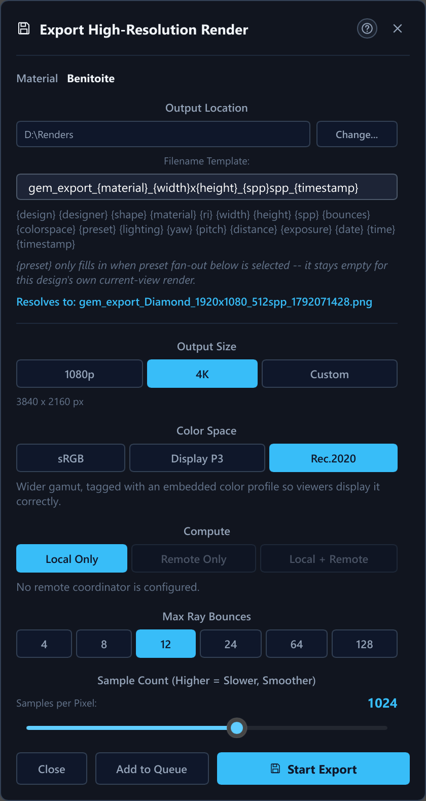

# 9. Rendering and Export

## What You Will Do

This chapter covers exporting a still image of the rendered stone: sizes,
sample counts, filename templates, choosing local or remote computation,
and what the app's "preview then handoff" behaviour means while you work.

## Opening the Export Dialog

From the Live Render viewport (Chapter 2), open **Export High-Resolution
Render**. The dialog has these sections.



**Remembered settings.** The dialog opens with the settings of your last export: the
output size, sample count, bounces, color space, compute choice and transfer. Starting
an export (or adding it to the queue) remembers the values it used, so the next dialog
starts there. These are the *output defaults* of the Parameters dock's **Render &
Output** tab, which lists them (Chapter 2); the dialog's own controls are per-export
overrides on top of them. The Tilt Video export keeps its own set the same way.

**Which material.** A line near the top of the dialog names the material the export
will use. It is the design's material, unless you are previewing another one (Chapter 6,
"Preview As..."), in which case the amber **Previewing** badge appears there too and the
export uses the preview material. Press **Back to Design** in the badge to export the
design's own.

### Output Location

A read-only field shows the folder your image will be saved to (or
"Chosen on first export..." if you have never exported before), with a
**Change...** button that opens a normal folder picker. The app only asks
once; after that it remembers your choice.

Below it, a **Filename Template** field lets you build the exported file's
name out of placeholders. Typing any of the following into the field
inserts that piece of information at that spot:

```
{design} {designer} {shape} {material} {ri} {width} {height} {spp}
{bounces} {colorspace} {preset} {lighting} {yaw} {pitch} {distance}
{exposure} {date} {time} {timestamp}
```

The default template is `gem_export_{material}_{width}x{height}_{spp}spp_{timestamp}`.
`.png` is added automatically if you don't type it yourself, and if a file
of that name already exists, the app adds `(2)`, `(3)`, and so on rather
than overwriting anything.

### Output Size

Choose **1080p**, **4K**, or **Custom** (16–8192 pixels per side, entered
directly).

### Color Space

Choose **sRGB** (the default, and what almost every viewer expects),
**Display P3**, or **Rec.2020**. The latter two are wider-gamut options and
carry an embedded color profile, so a viewer that understands it displays
the extra color range correctly rather than looking washed out or overly
saturated.

### Compute

Choose **Local Only**, **Remote Only**, or **Local + Remote**. If a usable
remote (coordinator) is already configured and reachable, **Local + Remote**
is selected for you by default; otherwise the remote options are shown
greyed out with the reason underneath (see Chapter 10 for what those
reasons mean and how to fix them).

### Transfer

Shown once the remote is available and Compute includes it: **Full Data**
(the remote's raw samples are merged with your own) or **Final Picture
Only** (the remote renders and tone-maps the whole image and sends one
finished PNG — much less data than Full Data). With **Compute: Local +
Remote**, your own CPU/GPU is not left idle even on Final Picture Only: a
toggle in the Render & Output tab's Compute section, "Final-Picture Exports: This Machine Renders a Share Too"
(on by default), traces a share of the samples locally and uploads it for
the coordinator to fold in before tone-mapping — turn it off if you'd
rather this machine sit out the export. The starting choice for Transfer
itself is the remote's own default ("Export Transfer (Default)" in the
Remote Coordinator form); see Chapter 10, "Transfer: Full Data or Final
Picture". The tilt video's export section has the same row.

With **Full Data**, the export does not hand the remote its whole share in one
go. It cuts the samples into requests and sizes each from the speed the
remote has shown so far: about 22 seconds of work per request for a single
worker, and up to about 90 seconds for a coordinator, which splits every
request across its own renderer and its joined workers and keeps them all
busy (one request never carries more than 65,536 samples, so a very fast
remote simply gets full-size requests back to back). The first request is a
short timing probe. For a coordinator the speed is measured over the whole
request, connection, upload and result transfer included, so the probe reads
low and the sizes settle on what the link and the remote really deliver
within a few requests.

### Max Ray Bounces

The same rung ladder as the live view (4/8/12/24/64/128), for this export only — it
starts at your last export's choice and is independent of the viewport's bounce
count. At 64 or 128, a note reminds
you this is noticeably slower on GPU hardware than on CPU.

### Sample Count

A slider from 8 up to 32768 samples per pixel. Higher counts mean a
smoother, less noisy image at the cost of render time. At the very top of
the range (16384/32768), the app warns this "can take hours, especially at
large output sizes."

### Also Render With Saved Lighting

If you have saved lighting marked as usable for export (Chapter 2, the Lighting &
Environment tab's **Saved Lighting**), you can tick any number of them here to render one
extra image per ticked lighting alongside your current view. Each extra image uses
that saved lighting's whole look: rig, light direction, exposure, surface glare,
backdrop, head shadow and HDR map (a lighting saved without a map renders without one).
Export time multiplies with how many you select. A lighting that uses an HDR
environment map is marked "HDR".

### While It Renders

A live thumbnail updates roughly twice a second so you can judge
composition and how far along the image is — this preview is always shown
in ordinary sRGB regardless of which color space you chose for the final
file, so do not judge final color from it. A progress bar and percentage
track completion; **Cancel Export** stops the job early.

### Add to Queue

Next to **Start Export** sits **Add to Queue**. It does not render anything now.
It saves your settings and a frozen copy of the stone as a render job, to be
rendered later, one job at a time, from **File → Render Jobs...**. **Start Export**
works as before and renders at once.

With presets ticked, each picture becomes its own job. Jobs are kept in your
library and can be paused, resumed and exported as a script. See Chapter 23.

### Which Stone Is Drawn

An export always draws the **finished** gem. The Edit tab's Cut slider (Chapter 13)
can show the stone part-way through the cutting, and the Live Render view follows it
(a badge over the picture says so and has a **Show Finished** button), but that is only
for looking. The high-resolution export, the extra preset images, the tilt video, the
tilt curves and their hover pictures, and every render done by a remote worker for an
export all draw the whole design, even while the slider is on an earlier step. The live
picture, including the part a remote worker traces for it, keeps following the slider.

## The Stone's Color in a Render

You can show a stone in another color without making a custom material. The design's own
color is set in the **Stone** tab's **Body Color** (Chapter 6): **Material Default** (the
material's own color), nine ready-made colors (the same nine as the Edit tab's color
box before: Clear, Blue, Red, Green, Violet, Yellow, Pink, Teal and Amber) and
**Custom...**, which opens the color editor (Chapter 6, Body Color) so you can choose
any color. That is always the design's own color: one undo step, and the design counts
as changed.

Two situations let you try a color without touching a design. In both, the color is a
view-only choice:

- **While previewing another material** (Chapter 6, "Preview As..."), the **Preview Color**
  control in the Stone tab changes only the picture. **Back to Design** clears it.
- **A catalogue row you are only browsing.** The Stone tab's **Color** changes this view
  only. The catalogue entry is never changed, and the app remembers the choice the next
  time it starts. Pick **Material Default** to clear it.

Whatever color the view shows is the color everything rendered from it uses: the live
picture, the metrics beside it, the tilt curves, high-resolution exports (including the
extra saved-lighting images), the tilt video, and renders done by remote workers. So an
export always matches the picture you were looking at.

A few details:

- The control is greyed out for a material that defines its own color (a custom material
  whose color comes from a physical recipe). Its hover note says so. The color is never
  replaced.
- A custom color is matched to the closest color the material model can show, so the
  result can differ a little from the exact color you picked. The button reads
  "Matching..." for a moment while that happens.
- A color is a what-if: the stone keeps its material's refractive index and dispersion,
  and the colored stone absorbs light evenly in every direction (a material's two-color
  effect, pleochroism, is not shown while a color is set).
- The Body Color box lists only the nine ready-made colors plus Custom. A custom color
  shows there as **Custom**, and choosing **Material Default** puts the material's own
  color back. Undo brings the custom color back.

## Stone Effects and Width in a Render

The stone's width and its four material effects (Inclusion Haze, Crystal Axis Orientation,
Frosted Girdle, Edge Rounding) belong to the design (Chapter 2, the Stone tab). Every
render uses the open design's values: the live picture, exports, saved-lighting images,
the tilt video and render jobs. A render job freezes them with the stone, so a queued
job renders the way the stone looked when you queued it, whatever you change afterwards.
A catalogue row you are only browsing is drawn with the girdle diameter its design file
sets (the default width of 7 mm when it sets none) and no effects, unless you set
view-only effects in the Stone tab. The library's preview thumbnails and tilt curves use
that same width, and the material the design file names, so a design looks the same in
its thumbnail, its tilt curves, the detail view and an export (Chapter 2).

## Lighting That a Design Remembers

A design can remember the lighting you like for it. The lighting is kept in your
library on this computer, never in the design file, so copying the file does not
copy it and saving never changes it.

To save it, set the lighting up the way you want in the live view, then open the
**Lighting & Environment** tab of the Parameters dock and look under **This Design**
(**Lighting This Design Opens With**). Press **Use This Lighting for This Design**. This
saves the lighting rig, the light's position and height, the exposure, the surface
glare, the head shadow, the backdrop and, if one is loaded, the HDR environment map. It
does not save the camera. (Lighting saved by an older version has no head shadow; it
opens with the default 16° one.) The button is
greyed out until a design is open (a new design, a file you opened, or a design you
loaded from the catalogue), and the line above it says so.

Press the button again at any time to replace what is saved. **Forget for This
Design** removes it and brings your normal lighting back.

When you open a design that has saved lighting in the editor (Open, Open Recent,
Load Selected or New), the live view uses it and a note says "Using this design's
saved lighting." When you then open a design that has none, the note says "Back to
your normal lighting." and the lighting you had before comes back. The saved
lighting never changes your normal lighting. Browsing a row in the catalogue list
does not apply it.

**Why browsing does not apply it.** A row you click in the catalogue list is only a
preview. It is drawn under the lighting you have set, not under that design's saved
lighting, so you can flip through many designs and compare them under one lighting.
The saved lighting comes back when you open the design in the Edit tab, because that
is when you are working on it, and it is keyed by that design's id.

A few details:

- While a design's own lighting is showing, you can still move the light, change
  the exposure or pick another lighting. Those changes last until you open another
  design. Press **Use This Lighting for This Design** to keep them.
- Applying one of your **Saved Lighting** entries counts as choosing your normal
  lighting, so it stays when you open other designs. The design keeps the lighting
  it saved.
- If the saved lighting uses a lighting rig this version of the app does not have,
  the app tells you once and uses your normal lighting. If the saved HDR
  environment map file has moved or cannot be read, the rest of the lighting is
  used, the current environment is kept, and the app tells you why.
- A large HDR map takes a moment to load when the design opens, and when the library
  is busy (an import is running, say) the saved lighting itself can take a moment to
  be read. If you load or clear an HDR map yourself in either moment, your choice
  wins: the saved map does not replace it, and **Use This Lighting for This Design**
  saves the map you chose. The rest of the saved lighting is still applied.
- The saved lighting belongs to the design's id, which Chapter 11 explains. A file
  that has never been saved gets the same id each time you open it, so it finds its
  lighting again.

## Custom Materials on a Remote Worker

A remote worker receives the whole material with every request, not just its name. For
a custom material that includes its **dispersion**: the Sellmeier or Cauchy
coefficients you typed in the Material Editor (Chapter 6). The worker therefore traces
the same color play you see on your own computer, and nothing has to be installed or
configured on the worker for it.

## What "Preview Then Handoff" Means While You Work

While you are dragging the camera or the light, the app is not trying to
produce a polished picture — it draws a cheap, rough local preview so
movement stays responsive. The moment you stop moving (about six-tenths of
a second of no input), if a remote coordinator is set up, the app starts a
fresh settled image and brings the remote in — nothing from the rough local
sketch is mixed into it. With **Live Compute: Local + Remote** your own
computer and the remote both keep adding samples to that one image until
together they reach **Target Samples**; with **Remote Only** the remote does
all of it. The remote sends back updates every "cadence" interval (half a
second by default), always sending at least a small update at least once
every two seconds even if there's nothing new worth showing. With **Live
Transfer: Final Picture** (set per remote, Chapter 10) it instead sends finished, denoised pictures of the
whole image and your own computer pauses (Chapter 10). If you grab the camera
again before it finishes, the app throws away the in-progress settled image
and drops straight back to the cheap local preview — the moving preview and
the settled image never blend.

An **HDR environment map** goes to the remote only if the remote reports that
it can render HDR scenes (Chapter 10); otherwise the live view and exports
render that scene on your own computer, with a one-time note.

**Motion Preview Resolution** (Off / Half / Quarter, in the Render & Output tab) controls how
coarse that moving-camera preview is: a smaller fraction renders faster but
looks blockier while you are actively orbiting or panning.

## What the "Worker Silent" Messages Mean

If you see a message like "Remote render failed: worker silent for 8s," it
means the app sent your remote worker something to compute and heard
nothing back — not even a routine status update — for the stated number of
seconds. For an ordinary render this limit is 8 seconds; for the very
first response after starting a fresh job it is more generous, 30 seconds,
to allow for a slow warm-up on a busy or cold machine.

This is not necessarily a sign of anything broken. With **Local + Remote**
selected, the app automatically falls back to finishing the work locally
and tells you it happened — you do not lose the samples the remote worker
had already completed. With **Remote Only** selected, there is no local
fallback, and the export or preview simply fails; switch to **Local +
Remote** or **Local Only** and try again.

If this keeps happening, check that the worker machine is turned on,
reachable on your network, and that its render-serving program is still
running — see Chapter 10.

## Next Steps

Continue to Chapter 10 to set up and troubleshoot a remote coordinator, or
Chapter 11 to understand the app's save formats. Chapter 23 shows how to
collect exports as render jobs and render them one after another.
