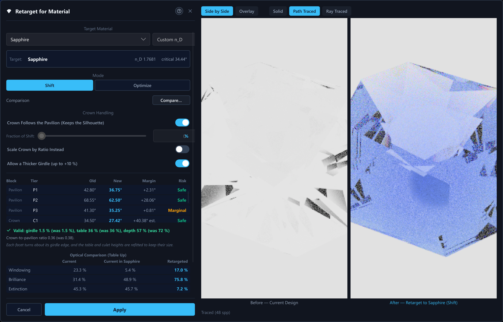
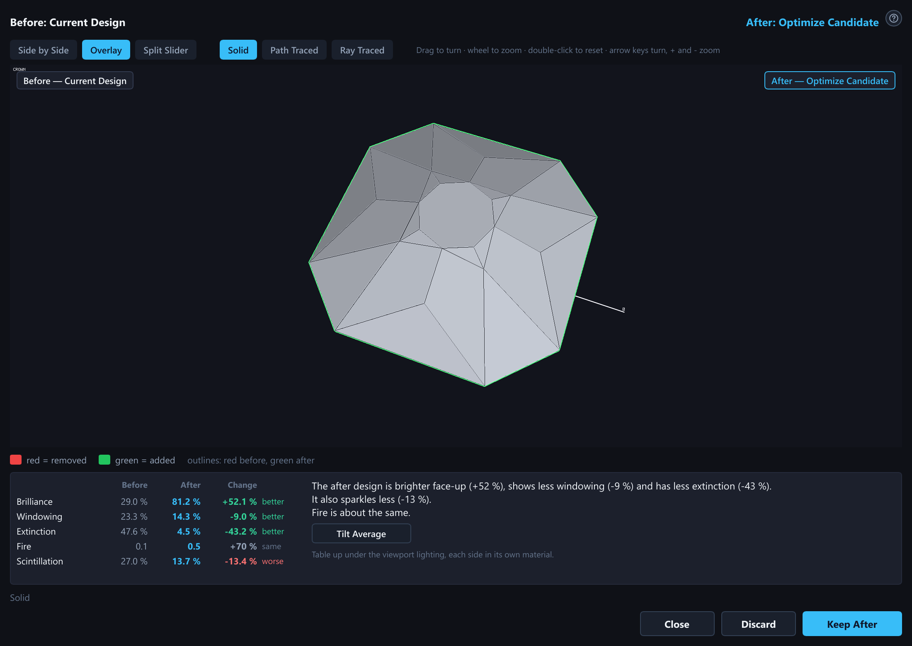
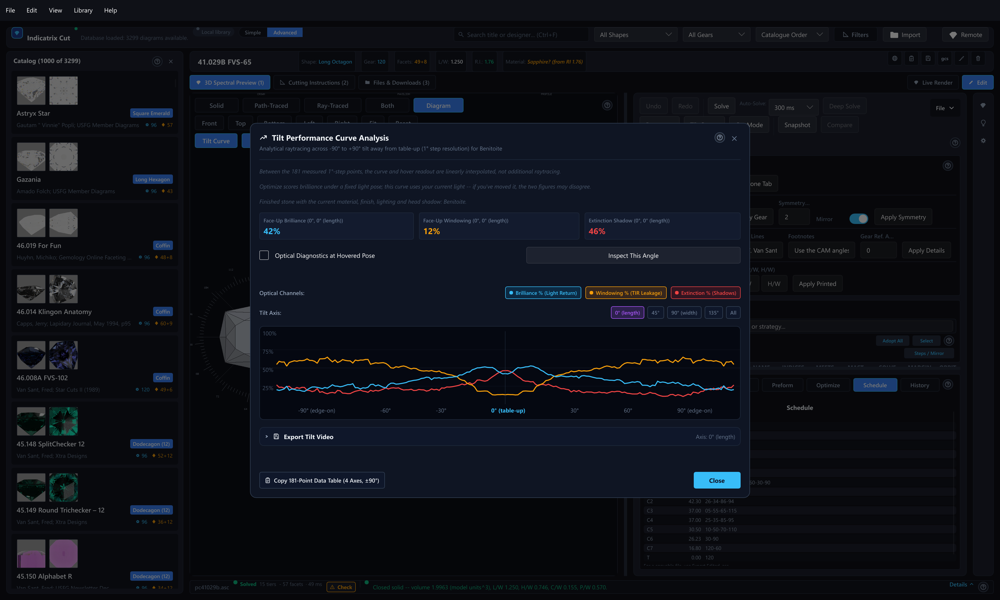
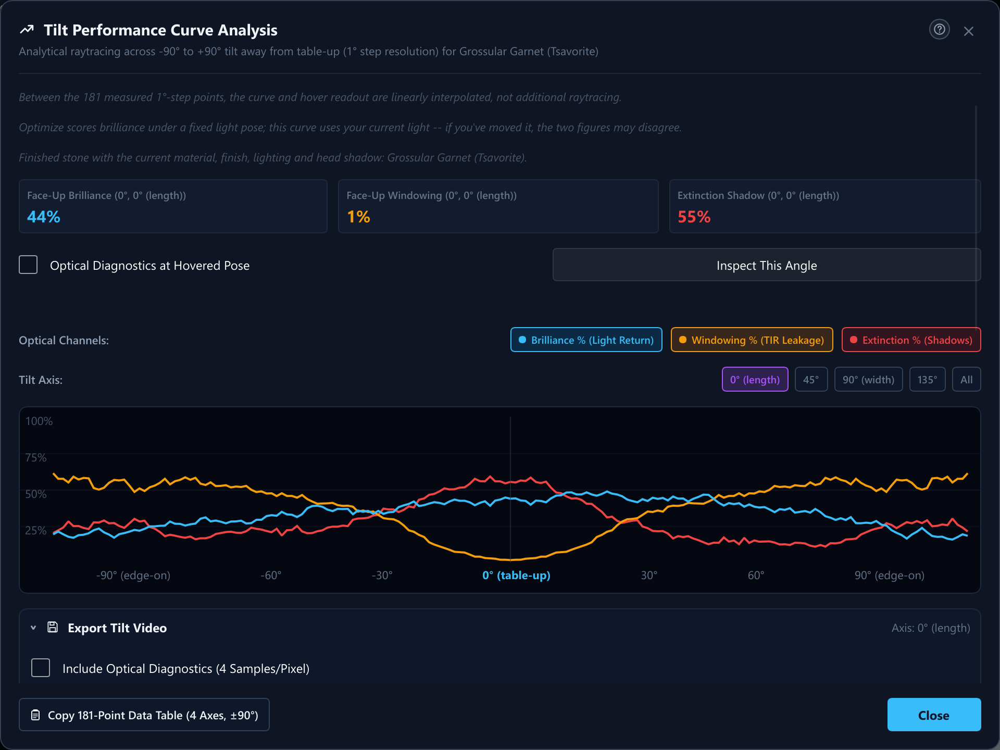

# 14. Retarget, Snapshot, Compare, and Tilt Curves

## What You Will Do

This chapter is a quick map of four related "compare two things" tools
scattered across the editor, plus one rule worth knowing before you rely
on any of them: which results actually survive after you close the
design.

## Retarget

Covered fully in Chapter 6. In one line: **Retarget...** proposes new
crown/pavilion angles for a different material and shows you a table of
what would change before you apply anything. It compares your current
design against a *hypothetical* re-angled version of itself, not against
another design or an earlier state.

Three things from that chapter matter when you compare. The table, the
culet and the girdle keep their angles (the table and culet are listed
greyed as **Not changed**); with **Allow a Thicker Girdle (up to +10 %)** on,
the girdle band may grow in thickness (never in outline) when a change would
otherwise pinch it, and the result text says so. The retargeted stone is judged before you can
apply it: the dialog shows **Checking...**, then **Valid: ...** with the
girdle and table figures and the stone's total depth (**depth 61 % (was
58 %)**), or **Not valid: ...** with the reasons and Apply
disabled. And **Compare...** keeps working on a change that is not valid, so
the visual comparison below is the quickest way to see what goes wrong; it
only waits while the check is still running.

## Snapshot Design and Compare to Snapshot

Two buttons on the command bar (**Snapshot** and **Compare**) let you diff your current
angles against an earlier point in the same editing session:

- **Snapshot Design** — hover hint: "Capture the current design and its
  solved masts, to compare against later." Click it to capture the
  design's tiers and their currently solved masts under a label built
  from the design's own name.
- **Compare to Snapshot** — hover hint: "Diff the current design against
  the last snapshot." Click it to open a dialog titled **Compare to
  Snapshot**, listing one row per tier with its name, its angle at
  snapshot time versus now, the signed change in solved mast, and a status
  badge: **Same**, **Changed**, **Added** (a tier that did not exist at
  snapshot time), or **Removed** (a tier the snapshot had that is now
  gone). Click **Done** to close it.

If you click Compare to Snapshot before ever taking one, you get a toast:
"No snapshot taken yet -- use Snapshot Design first."

**A snapshot is not saved anywhere.** It lives only in memory for the rest
of this session — closing the design, closing the app, or clicking
Snapshot Design again (which replaces it) all lose it. It is not written
to the `.isdd` file, and it is not the same thing as Deep Solve's
comparison against the catalogue's printed proportions (Chapter 8) — a
snapshot only ever compares the current design against your own earlier
click of Snapshot Design, never against catalogue data.

## Visual Before/After Comparison

The tables above tell you which angles move; the **compare window** shows
you what the stone looks like before and after. Open it with **Compare…**
in the Retarget dialog's Comparison row (once a proposal is ready and its
check has finished), with **Compare…** next to "Preview" in the Optimize tab (once a
result is waiting for Apply), or with **Compare Visually…** at the bottom
of the Compare to Snapshot table. It is a separate window you can move and
resize freely; opening it again replaces whatever it was showing. Both
sides are solved when it opens, so a large design may read "Solving both
sides…" for a moment.

Two layouts sit at the top left. **Side by Side** shows the two stones next
to each other; **Split Slider** shows one stone with a draggable divider,
the "before" design to its left and the "after" design to its right, both
rendered at exactly the same pose and size. Dragging in either image (or
anywhere in the split view) turns both stones together, the mouse wheel
zooms both, and a double-click resets them to the front view. **Solid**
(the default) is the Edit tab's flat grey view and updates instantly;
**Path-Traced** runs the path tracer at a modest fixed quality in the design's
own material (for Retarget, the "after" side uses the target material) and
starts once you stop turning the stone, showing the solid view meanwhile —
the status line reads "Tracing… 1 of 2" while it works. A side that does
not solve shows a hatched placeholder and the status line says why.

**Ray-Traced** uses eight deterministic AA taps with Fire for the same two designs
and materials. These are fixed for Compare: the tap count and Fire switch you chose
in Settings for the Ray-Traced view do not apply here, so both sides are always
drawn with identical options and the status line reads "Ray-Traced (8 taps)". It
needs no denoiser. Its color and frost are approximate; it omits
polarization, birefringent doubling, haze, zoning and edge rounding.
The optical numbers and tilt comparison still use
their own analytic tracer, regardless of the image renderer you choose.

Concave tiers (Chapter 16) are part of the stone: Compare draws and traces
the grooves and dimples of both sides, and the optical figures and the tilt
average are measured on the stone with its tools, so a groove can change a
figure. A concave stone traces more slowly than a flat one; if one concave
side takes more than 3 seconds, its next trace uses half the samples and the
status line names the side and the lower count. If a side's concave tiers
cannot be placed, the status line says so and the flat stone is shown and
measured instead.

**Keep After** applies the change exactly as the Retarget dialog's or the
Optimize tab's own Apply button does (one undo step, same checks), then
closes the window; it is disabled unless both sides solve, and if the
proposal changed after you opened the window you get a toast asking you to
open Compare again instead. A Retarget change that is not valid is refused
with the reason, just like the Apply button. For Retarget, the "after" side
is the stone with its facet heights adjusted, exactly what Apply would
leave. **Discard** closes the window without applying anything and switches
any viewport ghost preview off, leaving the proposal or result pending so
you can adjust it and compare again.
**Close** (or the window's own close button) just closes it. A snapshot
comparison only offers Close.

### Compare Against: The Current Design or the Original

When the comparison is opened from the Optimize tab, a **Compare Against:**
list in its header picks the "before" side: **Current design** (the default,
the design as it is now) or **Original (before retarget)**. The second entry
is offered only after you applied a Retarget in this session; it is the design
as it was just before that Retarget, held in memory like a snapshot (applying
another Retarget replaces it). It lets you judge an optimized, retargeted stone
against the stone you started with, each side in its own material. Opening
Compare again always starts on Current design. The Optimize tab's own baseline
and its accept gate stay tied to the design the search started from; only the
comparison window changes sides. The Retarget dialog's own comparison has no
such list.

### The Numbers Under the Pictures

Under the two stones the compare window shows a small table with the optical
figures of both sides, and a few sentences that say in words what changed. (The
Retarget dialog has its own table of numbers, so its embedded picture does not
repeat this strip.)

The figures are measured **table up**, which means looking straight down at the
table, with each side in its **own material** (for Retarget, the "after" side uses
the target material) and under the **lighting that was selected in the viewport when
you opened Compare**. If you change the lighting, open Compare again to measure
again. They are the same quick figures Optimize and the Angle Sweep use, so the
numbers agree with theirs.

| Figure | What it tells you | Better is |
| --- | --- | --- |
| **Brilliance** | The share of the light that comes back to your eye | Higher |
| **Windowing** | The share of the light that leaks out through the pavilion (the see-through look) | Lower |
| **Extinction** | The share of the light that is lost or trapped (the dark look) | Lower |
| **Fire** | How strongly the stone splits white light into colors (an index, not a percent) | Higher |
| **Scintillation** | How much the stone flashes on and off as it moves | Higher |

For each figure the table shows the value before, the value after, the change, and
a word: **better**, **worse** or **same**. The change is green when it helps and red
when it hurts, and which way helps depends on the figure: less windowing is better,
more brilliance is better. The change in brilliance, windowing, extinction and
scintillation is in **percentage points** (62 % to 66 % is +4). The change in fire
is **relative** (an index of 20 going to 21.2 is +6 %).

**What counts as the same.** Two stones are never measured to the last digit. The
measurement sends a grid of rays through the stone, and a single grid cell is worth
about 0.4 of a point, so a facet edge sliding across a few rays moves a figure a
little without any difference you could see. A change smaller than the threshold
below is reported as "about the same" instead of as a gain or a loss.

| Figure | Reads "same" when it moved by less than |
| --- | --- |
| Brilliance, windowing, extinction | 2 points |
| Scintillation | 3 points (it is a contrast figure and jumps more) |
| Fire | 5 % of the before value, and at least half an index point |
| Tilt averages (below) | 1 point (an average of 724 poses is much steadier) |

**The sentences** run from the most important change to the least: first brilliance,
windowing and extinction ("The after design is brighter face-up (+4 %) and shows
less windowing (-3 %)."), then fire and scintillation ("It also shows more fire
(+8 %)."), then the figures that stayed the same ("Extinction is about the same.").
When nothing moved beyond its threshold the strip says "No clear optical
difference." If a side does not solve into a closed stone there is nothing to
measure, and the strip says which side it is. In the Compare to Snapshot dialog the
same sentences appear under the title, with "the current design" as the subject.

**Tilt Average.** The button next to the sentences adds the average over four
directions and 181 tilt angles for both stones (1,448 measurements, a few seconds).
It runs in the background; the button turns into **Cancel** with the percent done,
and closing the window or opening another comparison stops it. When it finishes,
three rows are added (tilt brilliance, windowing and extinction) and one more
sentence, "Averaged over all tilts, ...". Fire and scintillation are not part of a
tilt sweep. These averages use the viewport lighting, so they can differ a little
from the curves in the Tilt Performance dialog, which has its own lighting.

## Tilt Curves: When a Computed Result Actually Persists

The **Compute Tilt Curves** button (and the catalogue-wide batch tool in
Chapter 2's Advanced Filters panel) always computes the full sweep and
shows it to you regardless of whether the design is saved. Whether that
result is then **kept** depends on one thing: does this design already
have a row in your catalogue?

- **Design already in the catalogue** (you loaded it from there, or have
  already run Save at least once): the curves are written back to
  that catalogue row, and you get a success toast, e.g. "Saved
  tilt-performance curves for this design." A later Tilt Performance
  filter (Chapter 2) can then use them without recomputing.
- **Design not yet in the catalogue** (a brand-new design, or one loaded
  as a placeholder reconstruction with no attached file): the curves are
  computed and shown in the dialog, but nothing is written anywhere. The
  toast says so directly: "Computed tilt-performance curves -- save this
  design to the catalogue to keep them."
- **Design edited while the sweep was running**: the result is discarded
  either way, with an info toast asking you to re-run it: "The design
  changed while computing tilt curves -- re-run to save an up-to-date
  result."

In short: compute tilt curves on a design you intend to keep only after
you have saved it into your catalogue at least once (Chapter 11), or plan
to recompute them once you have.

The catalogue-wide batch is different from the single-design button: it does
not show a result, it computes and saves the sweep of every design you chose.
With a remote coordinator configured and Live Compute including it, the batch
sends several designs to the remote at once (one request per design, so a
design's four axes are never split) — **Remote Lanes for Batches**, Chapter
10 — while your own computer works through the rest. A design the remote could
not sweep is computed on your own computer under **Local + Remote**, and
counted as failed under **Remote Only**.

## Exporting a Tilt Performance Video

The Tilt Performance dialog's **Export Tilt Video** section renders one
high-quality frame per swept angle (posed exactly like the dialog's own
hover preview), optionally overlays the swept brilliance/windowing/
extinction/angle values into each frame, then muxes the numbered PNG
sequence into an MP4 (or an animated GIF if `ffmpeg` is not on your PATH).

The section opens with the settings of your last video (resolution, samples, bounces,
color space, transfer and the folder-name template); starting a video remembers the
ones it used (the tilt video's *output defaults*, Chapter 2). A line in the section
names the material the frames will be drawn in; during a "Preview As..." session the
amber **Previewing** badge appears there too (Chapter 6).

Every frame renders through the SAME compute setup as a still-image export
(Chapter 9): whichever local CPU / CPU+GPU / GPU mode you have chosen in
the Render & Output tab, plus the remote coordinator if one is configured. With a remote
configured the section shows the same **Compute** pills as the export dialog
(Local Only, Remote Only, Local + Remote; the starting choice is Local +
Remote, with the usual graceful fallback to local-only rendering if the remote
is unreachable). **Remote Only** keeps this computer free: nothing is traced
here, no GPU is used, and the program only receives and saves the frames and
encodes the video, so you can keep working. Because there is nothing to fall
back to, a remote that is missing or stops answering stops the video with a
message; the frames already written stay, and a queued video continues with its
first missing frame when you resume it. Without a remote the video renders
locally and the Compute pills are not shown. The section also shows the same
**Transfer** row as the export dialog (Full Data, or Final Picture Only: one
finished PNG per frame from the remote -- Chapter 10), unless Compute is Local Only.
Because a video shares the app's single GPU adapter and the remote
with the rest of the app, the live viewport pauses for the whole
video's duration — exactly as it does during a still-image export — and
resumes automatically once the video finishes, is cancelled, or fails.

A video always draws the finished gem, even while the Edit tab's Cut slider is on an
earlier step (Chapter 9).

While the video renders, **Run in Background** closes the dialog and lets the export
go on. The header shows a chip such as "Exporting video -- frame 37 of 181 · about 2
min left", with a progress bar and a cross that cancels. Under Local Only and Local +
Remote it also says that the live view is paused while exporting. Click the chip to
open the dialog again with its live progress. When the video is finished, cancelled or
fails, a message appears even if the dialog is closed. The still-image export dialog
works the same way, and clicking its chip brings you back to Live Render. Only one export runs at a time: while one is running, every
button that would start another (Export, Start Video Export, the Jobs window's Start
Queue) is greyed out, and its hover note says so. **Add to Queue** stays available,
because it only saves a job. If you close the program while an export runs, it asks
first.

Next to **Start Video Export** sits **Add to Queue**. It saves the video as a render
job instead of rendering it now. A queued video can be paused, and when you resume it,
it continues with its first missing frame in the same folder. See Chapter 23.

In Simple mode (Chapter 17) the section hides Max Ray Bounces, Color Space, the remote
Transfer row and the folder-name template. They keep their saved values and still
apply, and the **Resolves to** line under the folder shows the name they produce.
Switch to Advanced to change them. The round **?** in the dialog's title bar opens the
manual page about the graph, and every chip and button in the dialog has a hover note.

## Stale Results

Retarget's held proposal and the Tilt Performance curves both carry a small
amber **Stale: Design Changed** badge whenever the result on screen no
longer matches what the design currently looks like:

- **Retarget**: badged the instant a further edit lands on top of an
  already-built proposal (Shift mode's own rebuild, or a finished Optimize
  search) — the table stays visible (it is still useful context), but the
  badge says plainly that it may no longer describe the design you are
  holding. Click **Recompute** on the badge to rebuild the proposal against
  the mode/crown/target controls exactly as they stand now, the same as
  changing any of those controls does.
- **Tilt curves**: badged whenever the geometry, material, or light the
  curves were swept against has moved since the last sweep actually
  finished. Click **Recompute** to re-sweep against the current inputs —
  the same action the existing "this curve was rendered with a different
  material" prompt already offers for a material change specifically; this
  badge also catches a geometry edit, which that one does not.

Deep Solve and Optimize carry the identical badge and Recompute action in
their own panels and in the status strip's Details popup — see Chapter 8.
The path-traced viewport (Chapter 5) carries the same badge too, over the
live render, with its "Recompute" action running a full Solve — the only
thing that can ever refresh a trace.

## Next Steps

Chapter 6 covers Retarget in full; Chapter 8 covers Deep Solve's own,
catalogue-proportion-based comparison; Chapter 11 covers Save and
what putting a design in your catalogue actually means.

## Inspect optical paths at a tilt angle

Tilt Performance uses the finished stone, even while the Live Render Cut slider shows an earlier cutting stage. Its active-session sweep and hover preview capture the resolved material and current preset/light pose or HDR map, including head shadow. Standardized catalogue and optimizer scoring keep their separate standard-lighting policy; stored library scores are not automatically replaced by current-view diagnostics.

The tilt curves also follow the stone's frosting: frosted facets (the Frosted Girdle switch and any tier you frosted) scatter light, so a frosted design's curves differ from its polished ones, and a design without frosting is swept exactly as before. Changing the frosting makes stored curves stale, and the next Tilt Curves batch recomputes them. The live Checks numbers and the optimizer's scores still treat every facet as polished.

Enable **Optical Diagnostics at Hovered Pose** to classify the preview at the same angle. **Inspect This Angle** opens the larger 360-pixel view; close it to return to the chart layout. Moving across the chart never changes the main camera. Each image and map are produced together by one cancellable latest-request worker. Status distinguishes an updating, ready draft or unavailable preview; outdated thumbnails are hidden.

The signed tilt convention is unchanged: positive/negative tilt selects opposite azimuths, and elevation is 90 degrees minus the absolute tilt. All four axes and fractional video angles use the same camera helper. The preview is labelled as a draft analytical model; its Fire overlay does not add Fire tracing to every curve point.

Tilt-video export has its own **Include Optical Diagnostics and Model Caption (4 Samples/Pixel)** checkbox. Direct and queued videos freeze this option and presentation with the finished scene. Every frame traces its exact pose at output resolution, using the same fixed Fire transfer range. A bottom caption identifies optical diagnostics model 1 and Fire as dispersion potential. One `optical.txt` file in the frame folder records the model, material, lighting, selection and the sweep (axis, start, end, step); the pose of each frame follows from the sweep. Existing performance-value rows remain at the top. Normal videos keep their previous appearance with the checkbox clear. Within a frame, the beauty render fills the first half of the progress and the diagnostic pass the second half. Cancellation is checked during the diagnostic tiles as well as the frame pipeline.

A paused or interrupted diagnostic video resumes only when its `optical.txt` is unchanged. If the diagnostic settings (or the sweep) changed since the frames on disk were rendered, or the frames were rendered without diagnostics, the resume stops with a message; restart the video to render every frame again. A video that is restarted without diagnostics removes the old `optical.txt`.
