# Indicatrix for Android

The phone and tablet app: a touch-first [Slint](https://slint.dev) UI over
`indicatrix-mobile-core` (the shared, UI-free core), packaged as a Gradle project with a thin
Kotlin `NativeActivity` shim. The same UI also runs in a desktop window for development
(the desktop preview, below).

**Status.** The app is not in an app store yet (there is no Google Play listing). Anyone can
build it and install it on their own Android phone or tablet: a debug APK from Android Studio
or from `gradlew assembleDebug` plus `adb install` (see "Build and run"). The same UI also
runs in a desktop window with the preview, no device needed.

## Screenshots

Phone (390 x 800):

<table>
<tr>
<td>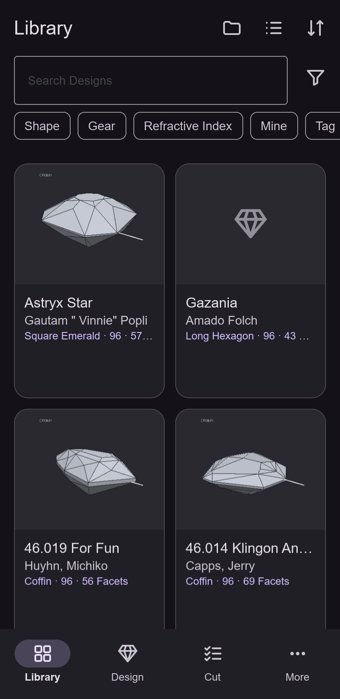</td>
<td>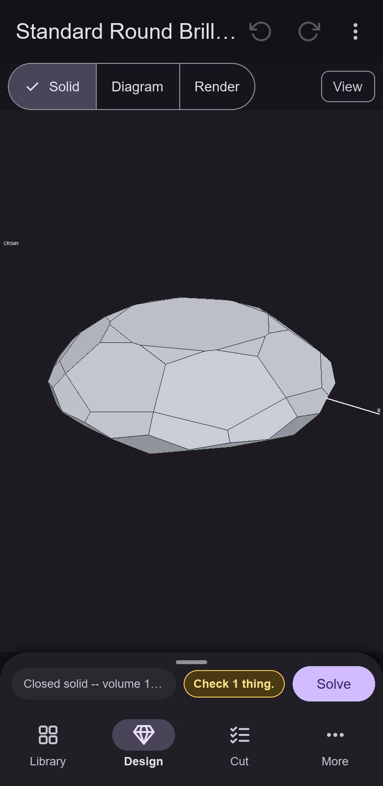</td>
<td>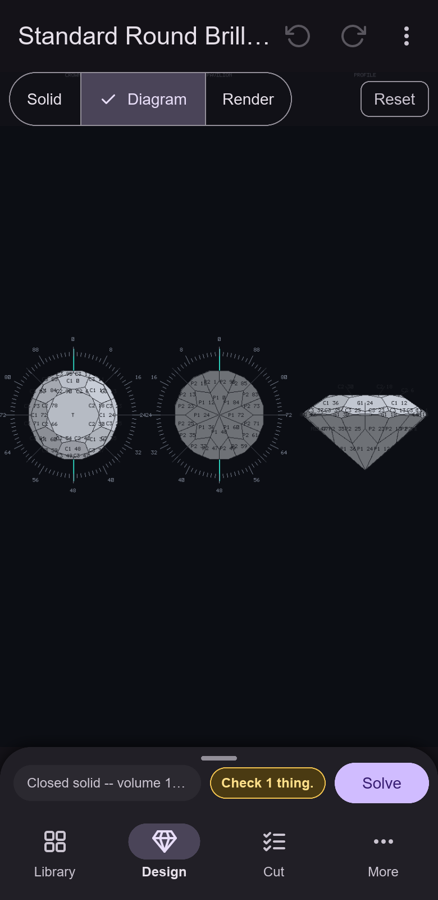</td>
<td>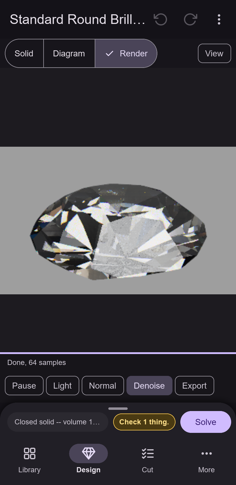</td>
<td>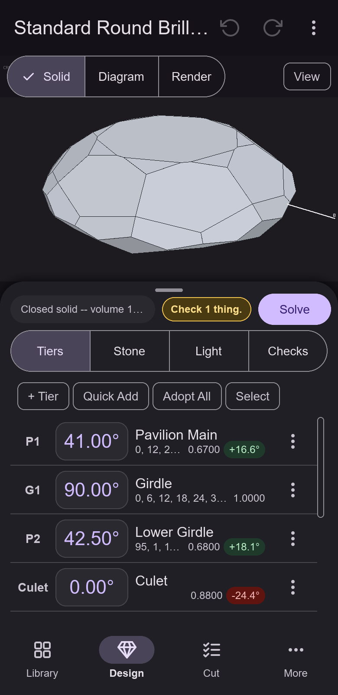</td>
</tr>
<tr>
<td>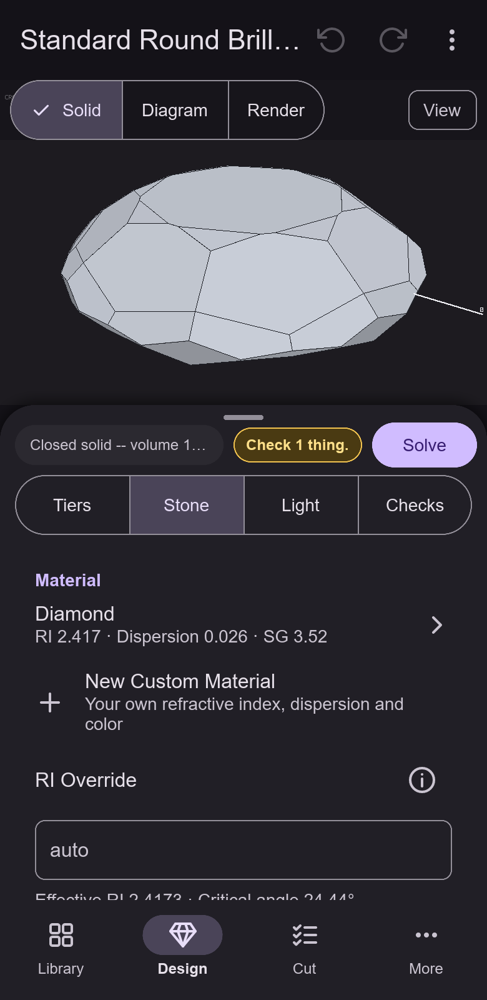</td>
<td>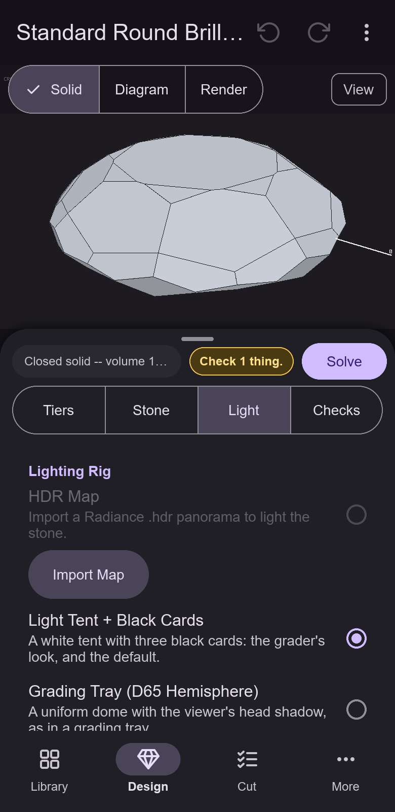</td>
<td>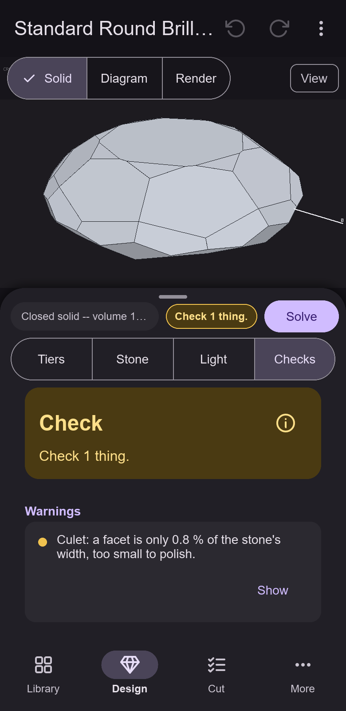</td>
<td>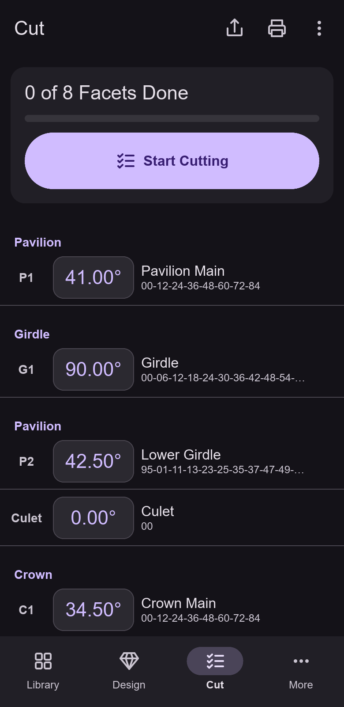</td>
<td>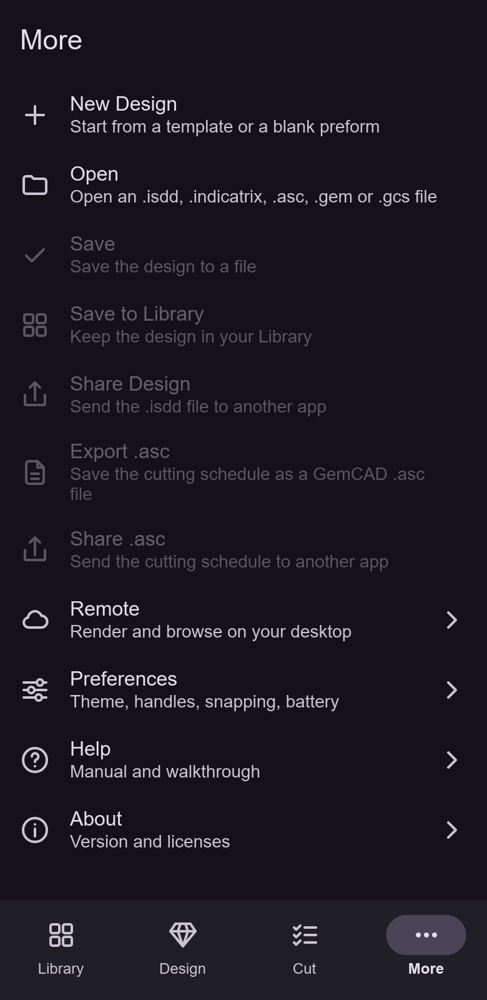</td>
</tr>
</table>

Tablet, landscape (1280 x 800):

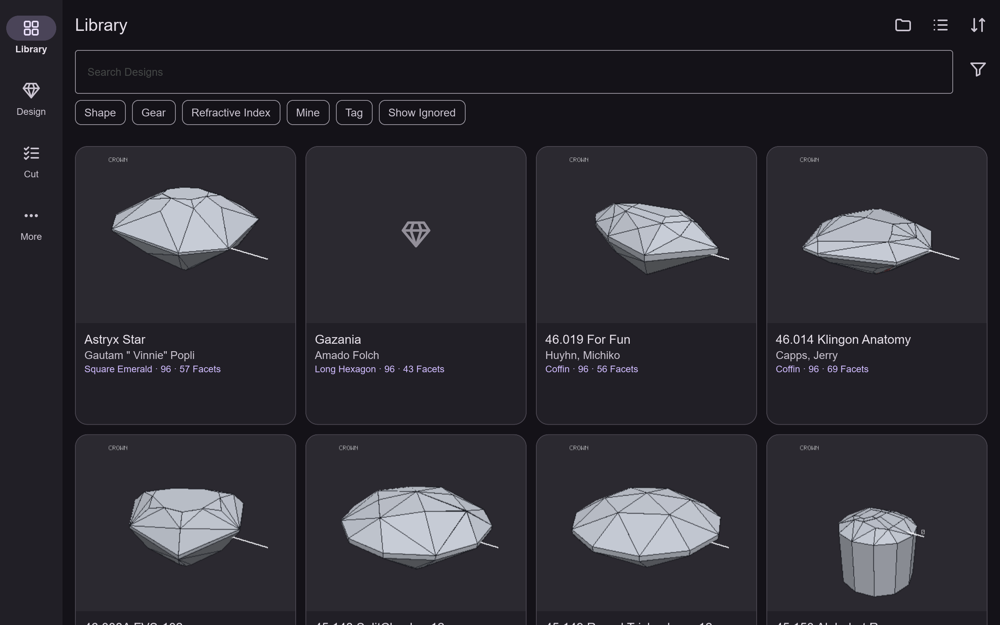
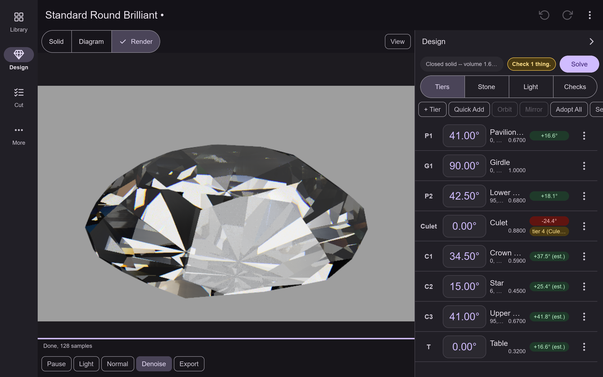
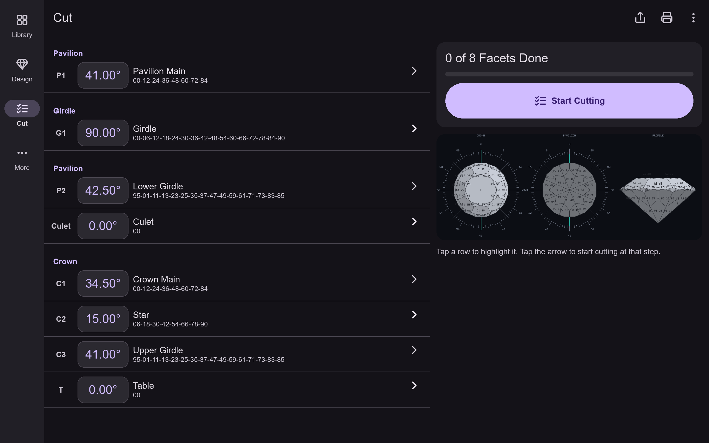

The pictures come from the desktop preview: `cargo ui-screens-mobile` (from the repository
root) rewrites `assets/mobile/`.

```
apps/indicatrix-mobile-android/
  src/android_entry.rs        android_main: logging, Slint backend, platform, run()
  src/platform_android/       the Platform implementation over JNI (Rust side)
  src/run.rs, ui/, ...        the UI (lane M1-b)
  android/                    the Gradle project (Kotlin side, manifest, cargo-ndk task)
```

Package and application id: `com.indicatrixsuite.mobile`. minSdk 28, targetSdk 36,
compileSdk 37, ABI `arm64-v8a`.

## One-time setup (Windows)

1. **Android Studio** (current stable) with, from the SDK Manager: Android SDK Platform 37
   (the `compileSdk`; the app targets API 36),
   Build-Tools (current), and **NDK r30** (side by side). JDK 17 is the one bundled with
   Android Studio (`<Android Studio>\jbr`) or any JDK 17.
2. **Rust target and cargo-ndk:**
   ```
   rustup target add aarch64-linux-android
   cargo install cargo-ndk --version 4.1.2 --locked
   ```
   For an emulator also `rustup target add x86_64-linux-android`.
3. **Environment variables** (user level, then restart Android Studio and shells):
   - `ANDROID_HOME` = the SDK directory, e.g. `C:\Users\<you>\AppData\Local\Android\Sdk`
   - `ANDROID_NDK_HOME` = `%ANDROID_HOME%\ndk\<r30 version folder>`
   - `JAVA_HOME` = the JDK 17+ directory (the Slint Android backend's build script runs
     `javac` and D8 against the platform's `android.jar`)
   - `ANDROID_JAR` = `%ANDROID_HOME%\platforms\android-37.0\android.jar`, needed for
     cargo commands you run yourself: the Slint build script cannot find a platform folder
     named `android-37.0` on its own and panics with "No Android platforms found". The
     Gradle cargo tasks set it automatically.
4. Skia is compiled from source on the first Rust build and needs host `clang`, Python and
   `ninja` on `PATH`. The first build is slow (tens of minutes); later builds are
   incremental. If the Windows-host cross build fails, build in WSL2 or on the Linux worker.
5. **Gradle wrapper.** The repository carries `gradle/wrapper/gradle-wrapper.properties`
   (Gradle 9.6.0) but **not** `gradle-wrapper.jar` or the `gradlew` scripts. Open
   `android/` in Android Studio once and let it sync: it creates them. (Alternatively run
   `gradle wrapper` in `android/` with any installed Gradle.)

Versions: Gradle 9.6.0, AGP 9.4.1 with its built-in Kotlin (no Kotlin plugin), and
`androidx.core` 1.15.0. `gradle.properties` carries no compatibility flags, so the build
uses AGP 9's defaults and the new variant API; keep it that way when Android Studio offers
an upgrade (its upgrade assistant adds `android.newDsl=false` and similar flags, which
only bring the deprecation warnings back).

## Build and run

**Android Studio:** open `apps/indicatrix-mobile-android/android`, pick a device
(USB debugging on) and press Run. The Gradle task `cargoBuildDebug` runs
`cargo ndk -t arm64-v8a -o app/src/main/jniLibs build -p indicatrix-mobile-android
--profile android-dev` from the repository root before every assemble, so the APK always carries a fresh library.

**Command line**, from `apps/indicatrix-mobile-android/android`:
```
gradlew assembleDebug
adb install -r app\build\outputs\apk\debug\app-debug.apk
adb shell am start -n com.indicatrixsuite.mobile/.MainActivity
```
For the emulator add `-PrustAbis=arm64-v8a,x86_64`. A release build is
`gradlew assembleRelease` (or `bundleRelease`), which builds the Rust library with
`--profile android-release`; the result is unsigned, signing and Play upload are the
owner's job.

**Rust only** (to see compiler errors without Gradle), from the repository root:
```
cargo ndk -t arm64-v8a build -p indicatrix-mobile-android --profile android-dev
```
The output is `target\aarch64-linux-android\android-dev\libindicatrix_mobile_android.so`.

**Page size.** Play requires 16 KB page support for updates from 2027-02-01. NDK r28+
links 16 KB aligned by default. Verify a built library with
`llvm-objdump -p libindicatrix_mobile_android.so` (every `LOAD` line should say
`align 2**14`) and an APK with `zipalign -c -P 16 4 app-debug.apk`.

## Logs

```
adb logcat -s indicatrix slint
```
`indicatrix` carries the app's own `log` output, the `tracing` events of the shared
crates (default level `info`) and Rust panics with a backtrace (addresses only in release
builds, which are stripped). `slint` is Slint's own tag.

## Desktop preview

The same UI in a desktop window at a phone or tablet size, with file pickers from `rfd`:
```
cargo run -p indicatrix-mobile-android --features desktop-preview --bin indicatrix-mobile-preview -- --size 390x800
```
(from the repository root). It exercises the UI and the core, not the Android services.

## How the Android services work

The Kotlin `MainActivity` is the NativeActivity instance, so Rust calls its public methods
by name over JNI (`src/platform_android/mod.rs`): `openDocuments`, `createDocument`,
`share`, `printHtml`, `setClipboardText`, `keepScreenOn`, `thermalHeadroom`, `openUrl`,
`cacheDirPath`. Each returns `null` or a message for the user. Answers to asynchronous
requests (pick, save) come back through three `native*` functions
(`src/platform_android/natives.rs`) tagged with the request id; files that other apps send
("Open with", "Share to") use request id 0 and are held until the UI registers its
handler. Limits on files read from other apps: 64 MiB per file, 256 MiB per request, 2,000
design files per picked folder.

## Known limitations

- **No TalkBack.** Slint exposes no accessibility tree on Android.
- **External mouse wheel.** The Android adapter of Slint 1.18.1 has a `todo!()` for scroll
  events (mouse wheel, trackpad scroll). A tablet with an attached mouse may panic when the
  wheel turns. Unverified; test it. The fallback is a patched copy of
  `i-slint-backend-android-activity` via `[patch.crates-io]`.
- **Back gesture.** The manifest sets `enableOnBackInvokedCallback="false"` so the system
  keeps sending `KEYCODE_BACK` to Slint. On API 36 devices Slint's own back callback is
  the other possible path. If Back does nothing or fires twice, flip the flag.
- **Soft keyboard.** Slint drives the keyboard through its own Java helper; numeric entry
  uses the app's own keypad, not the system numeric keyboard.
- **Printing** renders the cutting sheet in an off-screen `WebView`; the system print
  dialog's preview is the check that it came out right.
